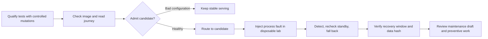

# 4. Deploy, Operate and learn: close the loop beyond merge

[Guide index](../README.en.md) · [中文](../zh/04-deploy-operate.md) ·
[Previous](03-build-verify.md) · [Next: engineering judgment](05-engineering-judgment.md)

First, this chapter explains exact-image acceptance using the current case.
It then introduces readiness, recovery and preventive methods, not completed
maintenance in the current demo repository.

## 4.1 Merge, publication and acceptance are different events

[](https://github.com/huangyingting/ai-native-sdlc-demo/actions/runs/38215333786/attempts/3)

**Ownership publication and verification, October 12, 2026.**
Inspect `publish` and `verify`, then the parent Intent's digest-bound record.
The Artifacts table's SHA-256 identifies a downloadable workflow artifact;
**it is not the GHCR image digest**.

In this repository:

1. Required review and checks permit a protected merge.
2. Publication builds and pushes an image.
3. Verification pulls the exact digest and starts a temporary container.
4. Exercise approved behavior against that artifact and record who ran the checks, results and limits.
5. Applicable acceptance closes the Intent.

The `it-service-desk-demo` Environment represents temporary container
verification, **not a permanently hosted public application**. A running local
container is not automatically upgraded by a merge.

Current ownership delivery record:

| Item | Value |
|---|---|
| Merged application revision | `1a1e14d0031305ee5da35c523ffbac9fa6f7e58b` |
| Publish/verify | Run `38215333786`, attempt `3` |
| GHCR image digest | `sha256:90836abf909410db91b0d3c791812683e5424c5cab7d7a84df1af6772a66ce76` |
| Acceptance | [Exact-image acceptance](https://github.com/huangyingting/ai-native-sdlc-demo/issues/1#issuecomment-6119642416) |

The [current case](https://github.com/huangyingting/ai-native-sdlc-demo/blob/main/docs/cases/ownership.en.md)
records the full image reference and observed checks. Create a dedicated volume and use an available
loopback port; do not attach an accepted instance's data to an experiment.

Attempt 2 failed with `permission_denied: write_package`. Job-level
`Packages: write` did not establish the package's access grant to this repository.
After the operator configured Actions access on the package, attempt 3 passed.
A successful build was not a successful delivery; the fix was authorization,
not a change to product code.

## 4.2 Exercise a user journey, not just an endpoint

[](https://github.com/huangyingting/ai-native-sdlc-demo/blob/main/docs/cases/assets/ownership/owner-handoff.png)

**Handoff, October 12, 2026.** Requester Maya Chen and owner Sam Rivera are
distinct. This capture uses the published image, not a source preview.

[](https://github.com/huangyingting/ai-native-sdlc-demo/blob/main/docs/cases/assets/ownership/owner-filter.png)

**Combined filters, October 12, 2026.** Sam Rivera, Open, High and `inc-1`
intersect using AND semantics. See the [evidence register](../evidence.en.md).

To accept the ownership feature:

1. Record the digest and verification attempt before opening the application.
2. Inspect existing records and the initial unassigned state.
3. Assign, reassign and clear an owner; compare detail and queue.
4. Reload and restart the same disposable data volume; inspect persistence.
5. Exercise exact filter sets, empty states and navigation.
6. Submit invalid inputs safely in the isolated environment; verify no mutation.
7. Check original create/status/search behavior.
8. Record what was actually observed and what was not tested.

Screenshots document visible states. Tests and read-only database comparisons
establish no-op writes, complete-field preservation and pre-change schema migration.
Neither source replaces the other.

After checking the application in your own exercise, an eligible reviewer submits:

```text
/sdlc accept sha256:<64hex>
<Actual scenarios, observations, evidence links and limitations.>
```

Reject with `/sdlc reject sha256:<64hex>` and actual failures instead. Replace
placeholders; never accept a digest you did not exercise. For a still-open run,
reverification invalidates earlier acceptance even if the digest is unchanged.
An accepted run is terminal; further delivery uses a new Intent.

In the current case, the assistant ran browser checks; the user individually
confirmed product decisions, approvals and acceptance. After acceptance the
Intent closed and temporary resources were cleaned up. This is not a continuously
hosted service or production certification; eight baseline dependency advisories remain.

## 4.3 Turn an operational observation into maintenance

Database readiness is not completed in the current case. This section explains
how to define that maintenance work, not an already delivered capability.

Process liveness does not establish dependency readiness, and neither replaces
user-journey verification. When observations reveal a gap, create a separate
maintenance Intent with the actual requests, configuration, responses and user
impact. Separate observations from hypotheses without rewriting prior approvals
or acceptance records.

A readiness specification should define dependencies, check timing, success
and failure responses, cache control, sanitized logging, and verification of
recovery and data preservation after configuration repair. Inject faults only
in isolated resources; acceptance should cover healthy, failed and recovered paths.

## 4.4 Three small reliability loops



These are reusable experiment procedures, not completion records for the current demo.

1. **Trustworthy verification:** run passing controls, inject each declared
   mutation, then restore and retest to check whether tests detect those errors.
2. **Safe local admission and recovery:** reject a misconfigured candidate;
   admit a healthy candidate; pause it; recheck stable before fallback.
3. **Operational feedback:** record incident/recovery observations, generate
   an unapproved maintenance draft, review and implement preventive scope,
   repeat relevant checks before closure.

Declare detection and recovery timing, sampling windows and data comparison
scope before execution. Follow the
[reliability guide](../../brownfield-reliability-loops.en.md) for procedures.
Short same-image, read-only-gateway drills do not establish production MTTR,
an SLO, write-traffic safety, cross-version rollback or backup restoration.

## 4.5 Recovery is not preventive closure

Returning traffic to stable answers “is the read journey working again?”
It does not answer “have we prevented recurrence?”

Maintenance work should link reviewed scope, an implementation PR and
post-change verification. Creating a draft alone does not establish completion.

For your own team, require an operational owner, observations separated from
hypotheses, proposed prevention, acceptance checks and a post-change result.
If the root cause is unknown, say so. “AI diagnosed it” is not root-cause evidence.

### Exit checklist and production gap

- [ ] Digest, source SHA, run and attempt all refer to the same delivery.
- [ ] User-journey observations accompany smoke verification.
- [ ] Fault drills use isolated resources and checked cleanup.
- [ ] Recovery and preventive completion have separate evidence.
- [ ] Maintenance links back to the observation without rewriting prior approvals.

Before production, add the controls appropriate to the system: independent
approvals, signed provenance/admission, authorization/privacy review, capacity
and load tests, cross-version database compatibility, tested backup restoration,
on-call ownership, SLOs and business-outcome measurement. These are **remaining
work**, not capabilities inferred from the screenshots.

[Next: evaluate changes, diagnoses and Agent strategies honestly](05-engineering-judgment.md).
