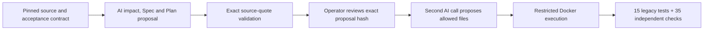

# 5. Change, diagnosis and Agent evaluation

[Guide index](../README.en.md) · [中文](../zh/05-engineering-judgment.md) ·
[Previous](04-deploy-operate.md) · [Next: workshop](06-workshop.md)

The previous chapters followed a feature delivery. These **engineering judgment
exercises** address three focused questions: how to identify change impact,
locate the faulty layer and compare Agent strategies fairly.

This chapter explains experiment design and evaluation methods without retaining
old experiment reports, screenshots or measurements. These cases are not completed
in the current demo repository; method descriptions are not delivery results.

## 5.1 Why a separate engineering lab?

Repeated fault injection and strategy comparisons should not modify the
accepted service desk or its approved contracts.
The independent [engineering fixture](../../../../demos/engineering-lab/README.en.md) therefore
provides a dependency-free synthetic Node.js application with its own manifest,
lockfile and tests. [Reusable tooling](../../../../tools/engineering-demo/README.en.md)
runs experiments outside the source checkout.

The committed fixture remains proxy-free so each experiment starts from the
same baseline. Experiment candidates remain separate from the accepted service desk.

## 5.2 Change impact: what does adding a field affect?

The request adds a temporary proxy without replacing the accountable owner:

```text
effectiveOwner = proxyOwner ?? owner ?? null
```

The tempting incomplete solution is to add a field to the returned JSON.
The complete change must also preserve storage, filtering and existing consumers.

| Surface | Required reasoning | Independent verification |
|---|---|---|
| Domain | Proxy precedence; owner remains accountable; AND filtering | Proxy/fallback/null cases and combined filters |
| Storage | Nullable `proxy_owner`; additive/idempotent migration | Pre-change schema and rows, preserved fields, reopen persistence |
| Mutation API | `assignProxy(id, proxyOwner)` validates IDs and owner values | Invalid input does not insert/mutate; null clears |
| Serialization | Preserve original fields; add `proxyOwner` and `effectiveOwner` | Exact field behavior including null |
| Documentation/consumers | Explain semantics and compatibility | Contract update; unchanged legacy tests and consumer behavior |



Execution should retain exact quotations, a hash-bound approval receipt,
the actual edit scope and independent check results. Record whether approval
included independent human review rather than equating operator confirmation
with independent review.

Separate **impact coverage** from **permission to edit**: analysis can cite
multiple facts in one file and unchanged consumers without gaining permission
to change those files.

**Transferable lesson:** impact analysis should include unchanged contracts
that must survive a change, not only files a model proposes to edit.

## 5.3 Diagnosis: determine which layer is wrong

Three fixed faults are applied independently to fresh identical copies:

| Case | Deliberate fault | Correct response | Wrong shortcut |
|---|---|---|---|
| Product | Owner/status intersection becomes OR | Correct the product predicate | Relax the expected result set |
| Test harness | An expected owner contradicts the unchanged contract | Restore the exact original assertion | Change correct product behavior to satisfy the drifted test |
| Environment | Database path points below `/dev/null` | Correct runtime configuration | Rewrite the store or keep retrying |

The Agent receives real failing output and relevant synthetic files, not the
expected fault label or independent oracle implementation. It must provide a
classification, exact evidence and minimal file changes. The host adapter
restricts paths; generated code executes only in non-root, read-only,
network-disabled, resource-limited Docker, with disposable temporary storage.

The CLI transport is deliberately qualified:

- Structured JSONL preserves exact response content and avoids terminal wrapping
  that can break JSON.
- An empty `--available-tools=` did **not** remove tools in the tested CLI.
  Explicit exclusions and observed zero-tool telemetry were required.
- Missing/unexpected telemetry or tool requests cause rejection.
- Docker setup/execution share a deadline; owned cleanup has a separate bound.

These controls constrain an authorized experiment. They are not a formal
sandbox certification or a guarantee that all future CLI versions have no
side effects. Requalify changed tool/event behavior before real use.

## 5.4 Compare strategies, not storytelling

Consider comparing:

- **Direct:** one response containing diagnosis and patch.
- **Diagnose-first:** one diagnostic response, then a fresh response proposing
  the patch using that handoff.

Two calls are not two independent human reviewers or necessarily different models.
Fix call and time limits before comparing, alternate execution order and use
the same source, faults and oracle. Declare retry and human-repair rules in
advance. Equal limits do not imply equal token use or actual spending.

Record repair correctness, evidence acceptance, scope compliance, actual calls,
usage, elapsed time and verifiable cost separately. Unknown cost remains unknown,
not zero. Define exact quotations and source paths in the evidence protocol;
after changing prompts or validators, rerun before claiming improved results.

Current metrics distinguish:

| Metric | Meaning |
|---|---|
| `repairsVerified` | Behavioral tests and independent oracle passed |
| `evidenceAccepted` | Diagnosis evidence satisfied its contract |
| `unacceptedCompletionClaims` | Claimed completion did not pass the full gate |
| `falseCompletionClaims` | Claimed repairs actually failed behavioral verification |

**A valid repair with a bad citation is not a false repair claim.**
Report sample size and failed attempts. Single trials on a few tasks cannot
establish a generally superior strategy.

## 5.5 Use traces to understand execution, not to substitute for quality

[](https://huangyingting.github.io/ai-native-sdlc/viewer/?run=36092002982)

**Figure G.** The Agent trace exercise's
[direct-execution trace](https://huangyingting.github.io/ai-native-sdlc/viewer/?run=36092002982),
captured October 12, 2026. The viewer's price-based **estimated cost** is not
invoiced spend and must not substitute for unknown costs in other experiments.

Read the page in this order:

1. Check run identity and observed model, not just requested model.
2. Read the hierarchy: orchestrator, model calls, tools and any subagents.
3. For parallelism, inspect overlapping independent branches, not agent count.
4. Inspect failures in context; a failed tool can be recovered within a successful run.
5. Check actual usage and cache treatment. Cached input is a subset of input,
   not extra input to add again.
6. Ask what product behavior the trace does **not** establish.

The [pattern guide](../../copilot-cli-agent-orchestration-patterns.en.md) covers
direct execution, parallel delegation, critic-reviser loops and sequential
pipelines. The pictured run illustrates direct execution only. A critic can
challenge assumptions, but an additional AI voice is not automatically
independent evidence.

### A reusable evaluation card

For each future experiment, declare before execution:

- Immutable source, task, allowed changes and hidden/independent checks.
- Strategy and model configuration; observed model after execution.
- Call/time limits, retry rules and human interventions.
- Functional outcome, regression outcome, evidence quality and scope compliance.
- Actual usage, unavailable telemetry, qualification overhead and failures.
- Sample size and what cannot be concluded.

Keep all attempts. Never convert unknown cost to zero, CLI usage units to dollars
without evidence, or repeated attempts into a selectively reported first success.

[Next: teach, reproduce and adopt this process](06-workshop.md).
