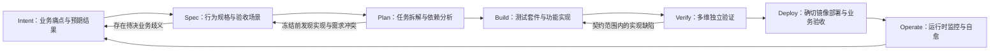

# 1. 流程总览：AI 提出方案，人做决策，用证据把关

[指南目录](../README.md) · [English](../en/01-operating-model.md) ·
[下一章：需求意图、规格说明与实施计划](02-intent-spec-plan.md)

## 1.1 什么是真正的 AI 原生（AI-Native）交付？

所谓 AI 原生软件交付（AI-Native SDLC），绝非仅仅让 AI 充当智能代码补全工具，而是让 AI 作为协作伙伴，全面深度参与需求澄清、架构设计、自动化测试、代码实现、独立验证与运维保障等全生命周期阶段。在此过程中，必须建立极其清晰的人机协作边界：**哪些任务交给 AI 提案，哪些关键决策必须由人类把关，以及每个阶段凭何种客观证据准入至下一阶段。**

在本体系的实践中，人机职责被清晰解耦为四重支柱：
1. **AI（Copilot / Agent）**：负责分析需求、挖掘规则歧义、起草规格说明与实施计划、编写测试用例与业务代码，并辅助诊断异常。
2. **人类架构师与业务代表**：负责把握业务取舍、裁决关键决策、审查技术方案，并最终签署风险验收。
3. **自动化门禁（GitHub Actions）**：依据预设规则严格检查审批权限、变更文件边界与生命周期阶段状态，对所有版本和执行记录进行留痕归档。
4. **真实运行时环境（Container Runtime）**：通过在隔离沙箱中真实拉起构建产物，以实际业务操作与健康探测验证交付质量。

这四项职责各自独立、紧密咬合，绝不能因 AI 输出了一句“已完成”，就草率越过任何一重门禁。

| 常见的偷懒捷径 | 本指南践行的工程规范 |
|---|---|
| 直接把一段需求丢给 AI，全盘接受生成的代码 | 先澄清业务痛点，严格前置审查规格说明（Spec）与实施计划（Plan），再检验实现 |
| 关键架构与产品决策只零散留在聊天会话里 | 将所有问题、裁决结论、文档版本及关联代码在 Issue 中结构化沉淀与归档 |
| 代码写完后再反推“测试该怎么写才算通过” | 测试套件先行审查，在进入编码前确立严格受控的失败断言（Red） |
| 看到流水线冒出一个绿勾就盲目认定交付完成 | 严格厘清单元测试、容器构建、镜像验证、业务验收与审计凭据各自的独立结论 |
| 赋予自动化智能体“既提方案又自我批准”的特权 | 严格隔离提案、代码执行与审批验收的权限主体 |
| 代码合并进主干后便彻底甩手不管 | 针对实际构建发布的生产镜像执行端到端验证，持续观测运行状态并规划维护迭代 |

上述模式是本体系经过充分实战检验的落地范式。但这并不意味着所有团队都必须强制使用 GitHub Issues，亦不代表所有变更都必须机械式地遵循严格 TDD。最值得各技术团队借鉴的核心原则在于：**先明确约定系统行为与验收标准，再留存足以严肃复核的客观证据链。** 本指南将所有经过严密审查确认的约定统称为“契约”（Contract）。

## 1.2 从需求意图到运维闭环：让反馈驱动持续演进



在敏捷闭环中，反馈可以随时驱动下一步工作的调整，但**绝不允许单次审批自动贯穿后续所有版本**。
在正式进入编码开发阶段前，一旦对规格说明（Spec）做出实质性修改，此前的审批凭证以及依赖该 Spec 的实施计划（Plan）将即刻自动失效，必须重新发起评审。
只有当实施计划获得正式审批后，契约才被正式冻结。此后若因不可抗力需要扩大业务范围或修正已冻结的测试工具，必须另行发起新的需求意图（Intent）或创建维护任务，清晰记录变更动机并完好保留既有历史痕迹。

| 交付阶段 | 核心要解决的问题 | 人类的核心职责 | AI 的角色与贡献 | 推进至下一阶段的准入凭据 |
|---|---|---|---|---|
| **Intent（需求意图）** | 为什么值得投入研发？ | 确立目标用户、核心痛点、优先级以及不做的边界 | 挖掘信息盲区，梳理备选方案 | 真实的业务现状调研与待决问题清单 |
| **Spec（规格说明）** | 怎样才算符合预期的正确行为？ | 澄清所有业务歧义，审查并批准确切版本 | 起草验收场景，将决策固化为规格文字 | 完整的决策回执、验收场景清单及带版本 Hash 的审批记录 |
| **Plan（实施计划）** | 如何在不破坏既有功能的前提下交付？ | 核查仓库现状、评估架构风险与技术依赖 | 细化任务依赖，设计验证与迁移方法 | 与已批准 Spec 验收场景精确映射的任务分解清单 |
| **Build（编码构建）** | 实际代码是否严谨兑现契约？ | 审查测试套件与业务实现代码 | 先编写针对性测试，再提交最小实现代码 | 精准匹配预期的红灯断言（Red）、已冻结测试未受篡改、改动范围受控的代码 Diff |
| **Verify（独立验证）** | 实际验证了哪些具体的边界行为？ | 评估测试覆盖的深度与遗留技术风险 | 分析测试失败根因，提出针对性改进补丁 | 既有回归测试全绿、功能测试全绿、独立判定器验证通过 |
| **Deploy（部署发布）** | 交付的产物是否正是经过验证的特定版本？ | 端到端操作应用，作出是否签署验收的决断 | 辅助构建打包，整理验证核对记录 | 代码合并 SHA、不可变镜像摘要（Digest）、Actions 运行编号与现场验收意见 |
| **Operate（运维维护）** | 服务是否稳定可用？后续如何演进？ | 明确系统恢复机制与预防性措施的主体责任 | 汇总运行时观测数据，起草运维维护任务 | 持续健康探测、数据持久化校验记录与归档的后续需求 |

## 1.3 核心主线案例与进阶工程专题

本指南第 2 至第 4 章以 **`ai-native-sdlc-demo` 演示仓库中的“工单负责人”真实交付** 为贯穿全篇的核心主线。
读者可以跟随一个真实需求的流转全景，清晰透视产品决策如何一步步转化为规格、测试用例与实现代码，并最终完成严谨的现场验收。
而关于数据库就绪健康检查、发布可靠性恢复以及工程评测实验等进阶内容，主要用于介绍严谨的工程方法论，不代表初始演示仓库一并自带这些功能。

| 实战案例 | 核心演示与方法价值 | 关键落地成果与指标 |
|---|---|---|
| **工单负责人完整交付：**[huangyingting/ai-native-sdlc-demo#1](https://github.com/huangyingting/ai-native-sdlc-demo/issues/1) | 从需求澄清、架构审批到端到端生产验收的全周期闭环 | 沉淀 4 项核心产品决策、Spec v5、Plan v1、38 项测试全部通过，以及基于指定发布镜像的人工现场验收 |
| **数据库就绪与可靠性演练** | 如何精准区分进程存活与数据库健康、检验测试有效性并实施自动回滚 | 严密的可靠性架构方法论；详见演示仓库的后续实践 |
| **工程决策与 Agent 评测** | 如何受控开展变更影响分析、故障根因诊断并公平评测 Agent 策略 | 严密的判定器（Oracle）与度量实验设计；详见工程专题 |
| **Agent 执行追踪（Trace Viewer）** | 如何系统化观测大模型调用时序、并发拓扑与 Token 开销 | 基于无外部依赖的标准工具套件，深入解析模型调用的真实执行流 |
| **现场过程截图清单** | 真实记录架构决策、同行审查、任务交接、组合筛选与镜像验收 | 完整归档 14 张高清过程截图；业务截图均直接截取自真实运行的生产镜像 |

在动手实操前，必须严格厘清**演练起点基线**与**最终交付结果**的本质区别。源仓库中的服务台应用特意保留了尚未实现工单责任人机制的初始基线，工程实验应用亦保留了无代理人的初始代码，旨在确保读者的每一次练习均能从相同的原点启程。而演示仓库则完整沉淀了该功能交付后的最终代码与历史全流程证据链。若要开展全新的从零演练，应基于源仓库的初始基线建立隔离副本，切勿直接在已完成交付的应用上重复实现相同功能。

详细的执行时间线、截图来源与验证覆盖面请查阅[证据来源与索引规则](../evidence.md)。

## 1.4 如何在 GitHub 中查验全链路证据？

| 平台页面或审计载体 | 该环节的核心操作与目标 | 该载体不能单独证明什么（防偷换概念） |
|---|---|---|
| **主需求 Issue 讨论区** | 审阅完整渲染的 Spec/Plan，开展交互讨论并提交正式审批指令 | 评审者一句口头的“看起来不错”，绝不能等同于系统已正式记录了审批指令 |
| **Git 文档专属分支** | 核验各版本 Spec、Plan 的真实内容与带时间戳的审批状态快照 | 文档文件存在于 Git 中，绝不代表该方案已被架构团队正式认可 |
| **测试套件 PR (Tests)** | 严格审查业务断言的覆盖有效性与预期失败清单（expected failures） | 测试用例数量多，并不能证明核心业务断言真正被有效执行 |
| **功能实现 PR (Implementation)** | 对照已冻结的规格契约，严格审查代码 Diff、架构合理性与安全边界 | AI 自行输出的“我已全部完成”总结，绝不能替代测试套件的真实 Green 状态 |
| **GitHub Actions 流水线** | 核验自动化检查项、源码提交 SHA、流水线运行编号（run）与执行轮次（attempt） | CI 绿灯通过，绝不代表所有复杂的业务行为在真实容器中均表现正常 |
| **容器镜像仓库 (GHCR)** | 通过不可变的唯一镜像内容摘要（Digest），精确锁定交付产物 | 动态的浮动标签（Tag，如 `latest`）或工作流构件 Hash，绝不能替代镜像摘要 |
| **服务台前端界面** | 在真实容器中以一线用户的视角，执行端到端的业务流转与多维筛选操作 | 静态截图本身无法证明数据库是否真正完成了底层数据落盘与向后兼容迁移 |
| **运行状态记录 / 只读回放** | 完整追溯文档版本、审批签名、运行状态与生命周期流转记录 | 查阅历史审计记录，绝不等同于重新发起了执行或签署了独立审批 |
| **调用链路追踪器 (Trace Viewer)** | 全景透视模型调用时序、工具调用请求、并发重叠窗口、错误与真实 Token 开销 | 追踪图谱展现的拓扑越复杂，绝不直接代表产出的代码或产品质量越高 |

在严格的工程体系中，任何一项审批指令均必须能够确凿回答：**究竟是谁，基于何种客观证据，批准了哪一个具体版本的文档或代码？**
而在最终的生产镜像验收环节，更必须斩钉截铁地回答：**业务人员验收的究竟是哪一个特定摘要的容器镜像，该结论基于哪一次流水线运行的实际验证结果？**
如果上述信息出现脱节或版本漂移，即便总结报告写得再具说服力，也极有可能是在用 A 版本的证据掩盖 B 版本的缺陷。

## 1.5 交付完成的黄金标准与证据闭环

即便是一个小型业务特性的交付，也必须至少形成如下严密完整的证据闭环：

```text
业务需求意图 (Intent) 与架构决策回执
  → 经人工正式批准的规格说明 (Spec) 与实施计划 (Plan)
  → 经前置审查的测试用例提交 + 精确受控的 Red 失败运行结果
  → 经代码审查的功能实现提交 + 全量转绿的 Green 运行结果
  → 严格遵循分支保护规则合并至主干的代码 SHA
  → 成功构建并经验证的不可变镜像摘要 (Digest) + 对应的 Actions run/attempt
  → 真实容器中的业务场景实测观察 + 授权审查人员明确签署的最终验收指令
  → 明确指定的运维责任人 + 沉淀归档的后续改进 Issue
```

工程交付流程必须与业务风险等级严格匹配。对于低风险的内部工具或演示练习，可依据明确规则由同一名工程师兼任不同阶段的审查角色；而对于涉及核心资产的高风险生产系统，则必须引入严格的多人同行审查、开发与部署权限分离、专业安全红蓝对抗与正式的变更委员会（CAB）审批。无论采用何种协作机制，团队都必须在审计记录中诚实呈现角色分工：由同一名工程师先后提交两次审批，或者让 AI 自我复核一次，绝不能粉饰为“由两位独立审查者完成了双重把关”。

### 研读本章后的核心反思

- 当 AI 提交了一份看似完美的实施方案后，团队内究竟由谁拥有签署晋级至下一阶段的法定权限？
- 能否在现有的工程流水线中，精准反查出某一次测试通过所对应的精确 Git 提交与容器镜像摘要？
- 当测试套件全量转绿之后，系统是否仍可能潜藏着未被断言覆盖的架构暗坑？
- 为什么在测试环境中跑通的演示流程，依然不能直接等同于生产就绪或商业价值兑现？

[下一章：将模糊的业务痛点转化为明确严谨的规格说明与实施计划](02-intent-spec-plan.md)。
