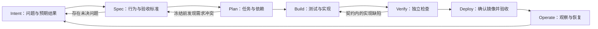

# 1. 流程总览：AI 提出方案，人做决策，用证据把关

[指南目录](../README.md) · [English](../en/01-operating-model.md) ·
[下一章：Intent、Spec 与 Plan](02-intent-spec-plan.md)

## 1.1 什么才是 AI-native？

AI 原生软件交付，不只是让 AI 帮忙写代码，而是让它参与需求分析、方案设计、
实现、验证和维护，同时明确：**哪些事由 AI 执行，哪些决定必须由人来做，
每一步凭什么进入下一阶段。**

在本仓库的实践中，AI 起草规格、计划、测试和代码，也协助诊断问题；
人负责产品取舍、审查方案和接受风险；自动化按既定规则检查权限、变更范围和
阶段状态，并保存版本与运行记录；应用的实际运行结果则用于检验交付是否符合预期。
这四部分各有职责，不能用 AI 的一句“已完成”代替其中任何一项。

| 常见捷径 | 本指南采用的做法 |
|---|---|
| 贴上需求，直接接受生成的代码 | 先澄清问题，审查规格和计划，再检查实现 |
| 决策只留在聊天里 | 记录问题、结论、文档版本及对应代码 |
| 写完代码后再决定怎样才算成功 | 预先审查测试，并用独立检查验证行为 |
| 看见一个绿勾就认为完成了 | 分清测试、镜像验证、功能验收和证据验收各自的结论 |
| 让自动化批准自己生成的内容 | 分开规定提案、执行和验收的权限 |
| 代码合并后就不再跟进 | 验证实际交付的镜像，观察运行情况，再安排维护 |

这些是本仓库的实现方式，并不意味着所有团队都必须使用 GitHub Issues，
或所有变更都必须测试先行。值得借鉴的是：**先约定行为和验收标准，再保留
足以核查结果的证据。** 本指南将这些经过审查的约定统称为“契约”。

## 1.2 从需求到运行，让反馈回到下一轮工作



反馈可以改变下一步工作，但不能让一次批准自动适用于所有版本。
在进入开发阶段之前，修改 Spec 会使原批准和依赖它的 Plan 失效，需要重新审查。
Plan 完整批准后，契约被冻结；此后若要改变范围，或修正已冻结的测试工具，
就需要另建 Intent 或后续任务，说明变更原因，并保留此前的记录。

| 阶段 | 核心问题 | 人的责任 | AI 的贡献 | 推进所需证据 |
|---|---|---|---|---|
| Intent | 为什么值得改？ | 明确用户、问题、优先级和不做的事 | 找出信息缺口，提出备选方案 | 实际观察，以及尚待确认的问题 |
| Spec | 什么行为才算符合预期？ | 解决歧义，批准当前版本 | 起草场景，把决策写入规格 | 问题处理记录、验收条件、版本及哈希 |
| Plan | 怎样交付，又不破坏已有功能？ | 核查仓库现状、风险和依赖 | 拆分任务，设计验证方法 | 与已批准规格及验收条件对应的任务 |
| Build | 实现是否符合约定？ | 审查当前版本的测试和代码 | 先提出测试，再提交实现 | 符合要求的 Red、保持不变的已批准测试、范围内的代码变更 |
| Verify | 实际验证了哪些行为？ | 判断覆盖范围和剩余风险 | 分析失败，提出修正 | 基线与功能测试结果、独立检查、失败记录 |
| Deploy | 交付的是否就是验证过的版本？ | 操作应用并决定是否验收 | 辅助打包，整理验证记录 | 合并 SHA、镜像摘要、运行编号与执行次数、验收观察 |
| Operate | 服务是否可用，接下来要改什么？ | 明确恢复责任和预防措施 | 整理运行观察，起草维护任务 | 持续探测、恢复与数据检查、后续任务 |

## 1.3 主线案例与专题案例

第 2–4 章以 **当前演示仓库的工单负责人交付** 为主线。
读者可以沿着一个需求，看清产品决定怎样进入规格、测试和实现，最终如何验收。
就绪检查、可靠性和工程评估使用单独的历史案例讲解，不代表本次演示已经完成这些工作。

| 案例 | 用来讲解什么 | 主要结果 |
|---|---|---|
| 工单负责人交付：[huangyingting/ai-native-sdlc-demo#1](https://github.com/huangyingting/ai-native-sdlc-demo/issues/1) | 从需求澄清到开发验收 | 四项产品决定、Spec v5、Plan v1、38 项测试通过，以及用户确认的镜像验收 |
| 就绪检查维护：[huangyingting/ai-native-sdlc-discovery-demo#8](https://github.com/huangyingting/ai-native-sdlc-discovery-demo/issues/8) → [huangyingting/ai-native-sdlc-discovery-demo#17](https://github.com/huangyingting/ai-native-sdlc-discovery-demo/issues/17) | 如何处理运行问题和测试工具缺陷 | 首次尝试取消；通过后续任务修正测试并交付 readiness，保留失败记录 |
| 可靠性专题 | 如何检验测试、控制流量切换并恢复服务 | 检出六个指定变异，完成同镜像恢复和维护跟进 |
| 工程判断专题 | 如何分析影响、诊断故障和比较策略 | 代理负责人变更通过 15 项原测试和 35 项独立检查；策略实验六次修复成功，但均未通过完整证据验收 |
| Agent 执行追踪专题 | 如何阅读调用过程和用量 | 用独立的直接执行示例介绍 Trace Viewer |
| 当前案例截图 | 产品决定、审查、交接、筛选和验收 | 演示仓库保存 14 张截图；应用截图来自实际发布的镜像 |

动手实践时，还要区分**演练起点**和**交付结果**。源仓库中的服务台尚未实现
工单归属，工程实验应用也尚未实现代理负责人，目的是让每次练习都能从相同起点开始。
当前演示仓库则保存了负责人功能和本次交付记录；就绪检查尚未在其中开展。
要从头练习，应使用演练起点，而不是在已经完成的应用上再次要求实现同一功能。

各案例的执行日期、截图来源和验证范围见[证据索引](../evidence.md)。

## 1.4 去哪里查看过程和结果？

| 页面或记录 | 在这里做什么 | 它不能单独证明什么 |
|---|---|---|
| 主 Intent Issue | 阅读完整 Spec／Plan，讨论并记录决策 | 一句“看起来不错”不等于系统已记录批准 |
| 文档分支 | 检查 Spec、Plan 和版本化审查状态 | 文档存在不代表内容被接受 |
| Tests PR | 审查断言和预期失败 | 测试数量不能说明关键断言是否执行到了 |
| Implementation PR | 对照冻结契约审查代码 | AI 的完成总结不是 Green |
| Actions | 检查任务、源代码版本、运行编号及第几次执行（attempt） | 任务通过不代表所有业务行为都已验证 |
| GHCR／镜像验证记录 | 用 digest 确定实际运行制品 | tag 或下载包摘要不是容器镜像摘要 |
| 工单队列／详情 | 按用户流程操作应用 | 截图不能单独证明数据持久化、无写入或迁移正确 |
| 运行记录／只读回放 | 追溯版本、批准和运行状态 | 查看记录不等于重新执行或独立批准 |
| Trace Viewer | 查看模型／工具调用、并发、错误和用量 | 图越复杂不代表产品质量越高 |

批准必须能回答：**谁，基于什么证据，批准了哪个版本？**
交付验收还必须回答：**验收的是哪个镜像，依据哪一次验证？**
如果这些信息对不上，即使总结写得很有说服力，也可能引用了另一个版本的结果。

## 1.5 怎样才算完成？

对一个小功能，至少保留以下链条：

```text
Intent 和决策
  → 已批准的 Spec + Plan
  → 已审查的测试提交 + Red 运行结果
  → 已审查的实现提交 + Green 运行结果
  → 经分支保护规则允许的合并 SHA
  → 已验证的镜像 digest + Actions run/attempt
  → 场景操作与观察 + 有权限的审查者验收
  → 运维负责人 + 后续任务
```

流程应与风险相匹配。低风险的内部变更，可以按明确规则由同一人承担多个角色；
高风险系统则可能需要独立审查、部署职责分离、安全验证和正式变更审批。
无论采用哪种方式，都要准确说明角色分工：同一人分两次操作，或让 AI 再检查一遍，
都不能算作两名独立审查者。

### 读完本章，可以想一想

- AI 提交方案后，谁有权批准进入下一阶段？
- 能否找到一次“成功”所对应的源代码版本和运行记录？
- 测试全绿后，还有什么不确定性？
- 为什么这些真实演练仍不能证明生产可用性或客户价值？

[下一章：把模糊的工单归属需求变成明确的规格和计划](02-intent-spec-plan.md)。
