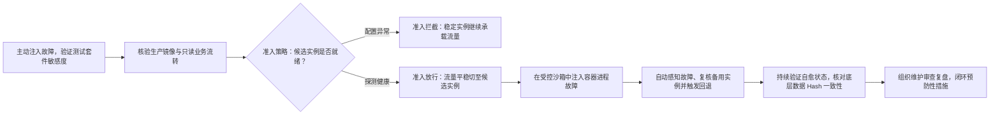

# 4. 部署、运行与维护：代码合并之后，工程闭环才刚刚开始

[指南目录](../README.md) · [English](../en/04-deploy-operate.md) ·
[上一章：开发与验证](03-build-verify.md) · [下一章：工程判断与 Agent 评测](05-engineering-judgment.md)

本章首先基于“工单负责人”真实交付案例，深入讲解如何针对一个特定版本的不可变容器镜像完成端到端现场验收；随后系统介绍数据库就绪检查、自动故障恢复与预防性运维的工程落地范式。后半部分关于可靠性演练的方法论属于通用实践指导，演示仓库中的后续进展请查阅对应专题。

## 4.1 核心认知：代码合并、镜像发布与业务验收是三个完全独立的生命周期事件

[](https://github.com/huangyingting/ai-native-sdlc-demo/actions/runs/38215333786/attempts/3)

**工单负责人发布与验证实录（2026 年 10 月 12 日）**：请首先查验流水线中的 `publish` 与 `verify` 任务日志，随后核对主 Issue 中登记的精确镜像内容摘要（Digest）。需要注意：Actions 构件表（Artifacts）中展示的 SHA-256 仅代表工作流打包文件的 Hash，**绝非 GHCR 容器镜像的 Digest**。

在本交付体系中，生命周期流转遵循严格的五步法则：

1. **分支保护准入**：只有所有必需的同行审查与静态/动态门禁全量通过，分支保护规则才允许代码合入主干。
2. **自动化流水线构建**：发布任务在隔离环境中构建不可变 Docker 镜像，并推送至容器镜像仓库（GHCR）。
3. **拉起临时验证沙箱**：验证任务基于刚刚生成的镜像 Digest 显式拉取镜像，拉起临时独立的容器实例。
4. **端到端业务验收**：业务或测试人员在该真实运行的容器上逐项核对验收场景，详实记录执行人、实测结果与未验证项。
5. **正式签署验收**：只有当人工验收指令校验通过并沉淀审计回执后，主 Issue 需求才宣告正式关闭。

流水线中的 `it-service-desk-demo` 环境仅用于临时容器的冒烟验证，**不代表长期在线的对外生产服务**。代码合并到 Git 分支，绝不会自动热更新本地已经启动的历史容器。

本次交付的完整审计记录如下：

| 交付审计项 | 精确记录值 |
|---|---|
| **合并后的应用版本 (Commit SHA)** | `1a1e14d0031305ee5da35c523ffbac9fa6f7e58b` |
| **GitHub Actions 运行编号与轮次** | Run `38215333786`，Attempt `3` |
| **GHCR 生产容器镜像摘要 (Digest)** | `sha256:90836abf909410db91b0d3c791812683e5424c5cab7d7a84df1af6772a66ce76` |
| **现场业务验收决策记录** | [确切镜像的验收记录与回执](https://github.com/huangyingting/ai-native-sdlc-demo/issues/1#issuecomment-6119642416) |

[工单负责人图文案例实录](https://github.com/huangyingting/ai-native-sdlc-demo/blob/main/docs/cases/ownership.zh-CN.md)
完整收录了镜像全名与现场实测结果。在本地开展练习时，请务必单独创建测试数据卷并指定独立的回环端口，切勿将已验收环境的数据卷直接挂载至实验容器。

真实交付往往伴随着真实的工程摩擦：本次发布流水线在第 2 次执行时，曾遭遇 `permission_denied: write_package` 鉴权失败。日志中的 `Packages: write` 仅代表工作流令牌具备包写入能力，并不等于 GitHub Packages 现存的包资源已向当前仓库下发了授权。操作者介入并在包设置的 **Manage Actions access** 中显式为当前仓库授予 **Write** 权限后，第 3 次发布重试即刻成功。这属于纯粹的外部云基础设施权限修复，而非修改业务代码，更不能把“构建编译成功”盲目等同于“交付发布成功”。

## 4.2 还原真实业务视角：按用户操作链路严肃验收

[](https://github.com/huangyingting/ai-native-sdlc-demo/blob/main/docs/cases/assets/ownership/owner-handoff.png)

**流转交接实测截图（2026 年 10 月 12 日）**：工单申请人 Maya Chen 与当前责任人 Sam Rivera 清晰区分展示。截图直接截取自已发布的正式 Docker 镜像，绝非本地热更新的源码预览。

[](https://github.com/huangyingting/ai-native-sdlc-demo/blob/main/docs/cases/assets/ownership/owner-filter.png)

**多维组合检索实测截图（2026 年 10 月 12 日）**：`Sam Rivera` + `Open` + `High` + `inc-1` 共同发挥过滤效力，系统严格按 AND 逻辑呈现交集。截图来源与校验见[证据索引](../evidence.md)。

在验收工单责任人特性时，标准的操作顺序应为：

1. 记录拉取镜像的唯一 Digest，核对对应的 Actions 流水线运行编号与轮次。
2. 检索历史存量工单，核对存量工单与新建工单的默认“未分配”状态。
3. 交叉执行指派、更换负责人与清空分配操作，严格比对详情页展示与列表页摘要的一致性。
4. 强制刷新浏览器页面，并在同一持久化数据卷上重启容器，核对流转结果是否可靠落盘。
5. 验证多维组合筛选的精确集合表现、空结果占位，以及浏览器前进/后退时的状态同步。
6. 在隔离环境中提交越界参数或非法人员姓名，确认服务端能够友好拦截且数据库不发生脏写入。
7. 对工单创建、状态流转与全文检索等既有核心流程执行全量功能回归。
8. 如实记录现场测试观察到的事实，并清晰注明未被本次操作覆盖的边界。

前端 UI 视角的交互核验与底层数据库审计相辅相成。例如，要确认“重复选择相同负责人不产生冗余写入”以及“表结构升级完整保留存量字段”，仅凭肉眼看页面远远不够，必须配合底层的 SQLite 数据版本核验与表结构比对。

在个人演练中，具备权限的审查者在完成全面核验后，于主 Issue 中提交验收指令：

```text
/sdlc accept sha256:<64hex>
<在此详细列出实际验证的业务场景、客观观测结果、证据链接以及未验证项边界。>
```

若核验发现重大缺陷，则提交 `/sdlc reject sha256:<64hex>` 并详述失败现象。指令中的占位符必须替换为真实的 64 位哈希，且审查者仅对自己真实操作体验过的确切镜像签署决断。在未关闭的交付流转中，即使 Digest 保持未变，触发新的构建验证也会使先前的验收自动作废；而一旦验收通过且 Issue 正式关闭，该交付即进入终态不可篡改，后续的需求扩展必须建立新的 Intent。

在当前演示案例中，浏览器端操作核验由 AI 助手辅助执行，而业务决策、阶段性门禁批准与最终镜像验收均由人类工程师逐项把关。验收签署后，需求 Issue 正式关闭，临时容器与数据卷按规程清理销毁。需要指出的是：基线中遗留的 8 项依赖安全告警尚未在本次范围中处置，业务功能验收绝不等同于全方位的生产环境准入审计。

## 4.3 闭环运维：从运行时真实问题中孵化维护需求

进程存活探测（Liveness）绝不等于外部依赖健康可用（Readiness），而这两者亦绝无法替代用户的真实业务操作核验。
当生产或演练监控捕获到底层依赖隐患时，团队应当另行创建运维维护需求（Intent），忠实记录真实的请求特征、环境配置、报错响应与潜在影响面，严谨区分“观测事实”与“待证假设”，绝不篡改历史交付的既有审批记录。

就绪健康检查（Readiness Probe）的规格说明应重点明确：探测哪些依赖服务、探测触发时序、就绪与不可用时的 HTTP 状态码与响应体、缓存控制（Cache-Control）、敏感日志脱敏，以及配置修复后的自愈恢复与存量数据持久化保证。故障注入演练严格在隔离沙箱中展开，验收标准必须覆盖正常通路、异常拦截与自愈恢复全链路。

## 4.4 可靠性工程的三个黄金验证闭环



以下为推荐的标准化可靠性演练框架：

1. **测试套件可信度验证**：先验证既有代码测试全绿，随后逐项主动注入代码变异（如漏读数据库、掩盖异常等），断言测试套件能精准变红报错，最后复原代码复测全绿。
2. **流量调度与故障自愈演练**：网关准入策略精准拦截存在配置缺陷的实例，平稳放行健康候选实例；在候选容器遭遇进程故障后，网关在判定备用实例健康的前提下，精准触发 1 次回退切流。
3. **运维反馈与防复发闭环**：详实记录故障注入与恢复全过程指标，由系统生成结构化维护草案。经团队同行审查确立根因与预防性措施后，落地工程改造并再次执行演练闭环。

在开展演练前，团队应清晰界定故障检测时间、恢复判定时延、健康采样窗口以及底层数据比对的标准，具体规范请参阅[可靠性演练指南](../../brownfield-reliability-loops.md)。需要提醒的是：基于同一镜像与本地只读网关的短周期故障演练，无法直接外推为生产环境的真实 MTTR 或 SLA 承诺，亦无法替代复杂生产环境下的高并发写流量竞争、跨大版本数据库回滚或异地容灾备份演练。

## 4.5 故障自愈恢复不代表预防工作彻底终结

流量在发生故障后平滑切回稳定实例，仅能证明系统的自动降级与恢复机制生效。要从根本上杜绝类似故障在生产环境中重演，必须扎实推进后续的预防性工程建设。

运维任务必须紧密关联经审查通过的改动边界、具体的修复 PR 以及修改后的严格验证记录，切不可将一份自动生成的复盘草稿误当成防复发工作的终点。

在工程实践中，必须明确指定运维跟进负责人，清晰区分“已观测到的真实数据”与“推测性的待验证归因”，详尽记录防御方案、验收手段与上线后的监控表现。若故障根因在短期内尚未彻底查清，应诚实地将其列为高优先级的待查任务，杜绝随意编造推论草率结项。

### 生产准入前的前置深度核验清单

- [ ] 容器镜像 Digest、源代码 Commit SHA、Actions 运行编号与轮次严格属于同一次交付流水线。
- [ ] 除通过自动化冒烟测试外，已严格按照真实业务链路完成了全流程端到端验收。
- [ ] 所有故障注入与演练均使用专属隔离资源，并在演练结束后彻底销毁清理。
- [ ] 服务的自动恢复机制与长效预防性措施各自具备可追溯的独立验证记录。
- [ ] 运维任务严格关联原始故障现场，绝不回溯篡改既有的交付审批凭证。

在正式投产商用前，团队还应结合系统风险等级补充以下生产级保障：独立的多人安全审批、镜像数字签名（如 Cosign）与安全供应链来源验证（SLSA）、受控的金丝雀发布门禁、合规与隐私审计、高并发容量压测、跨版本数据库兼容性演练、定期冷热备份恢复演练、完备的 SRE 值班响应机制与端到端 SLO 业务监控。这些生产级保障不包含在当前基础演示案例的交付范围内。

[下一章：深入变更影响分析、故障根因诊断与 Agent 策略科学评测](05-engineering-judgment.md)。
