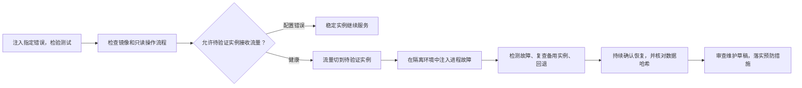

# 4. 部署、运行与维护：合并代码之后，还要做什么？

[指南目录](../README.md) · [English](../en/04-deploy-operate.md) ·
[上一章](03-build-verify.md) · [下一章：工程判断](05-engineering-judgment.md)

本章先用当前案例说明怎样验收一个明确的镜像版本，再介绍就绪检查、
故障恢复和预防措施的方法。后半部分不是当前演示仓库已经完成的维护工作。

## 4.1 合并、发布、验收是三件不同的事

[](https://github.com/huangyingting/ai-native-sdlc-demo/actions/runs/38215333786/attempts/3)

**工单负责人功能的发布验证，2026 年 10 月 12 日。**
先看 `publish` 和 `verify`，再看主 Intent 中对应镜像摘要（digest）的记录。
Artifacts 表里的 SHA-256 标识工作流下载包，**不是 GHCR 镜像的摘要**。

在这个仓库中：

1. 必需的审查和检查通过后，分支保护规则才允许合并。
2. 发布任务构建并推送镜像。
3. 验证任务按镜像摘要拉取指定版本，启动临时容器。
4. 在该版本上执行验收场景，明确记录执行者、结果和未验证项。
5. 验收满足规则后，才关闭 Intent。

`it-service-desk-demo` Environment 用于临时容器验证，**不代表持续在线的公开服务**。
代码合并也不会自动更新已经启动的本地容器。

本次交付记录如下：

| 项目 | 值 |
|---|---|
| 合并后的应用版本 | `1a1e14d0031305ee5da35c523ffbac9fa6f7e58b` |
| 发布／验证 | Run `38215333786`，attempt `3` |
| GHCR 镜像 digest | `sha256:90836abf909410db91b0d3c791812683e5424c5cab7d7a84df1af6772a66ce76` |
| 验收 | [确切镜像的验收记录](https://github.com/huangyingting/ai-native-sdlc-demo/issues/1#issuecomment-6119642416) |

[完整交付记录](https://github.com/huangyingting/ai-native-sdlc-demo/blob/main/docs/cases/ownership.zh-CN.md)
包含镜像名称和实际核验结果。练习时请单独创建数据卷，并使用可用的回环端口；
不要将已验收实例的数据挂载到实验容器。

发布并非一次成功：第二次执行因 `permission_denied: write_package` 失败。
日志中的 `Packages: write` 不等于现有镜像包已经授权给当前仓库；
操作者配置包的 Actions 访问权限后，第三次执行才成功。这里需要修正授权，
不是修改业务代码，也不能把构建成功当成交付成功。

## 4.2 按用户的操作流程验收

[](https://github.com/huangyingting/ai-native-sdlc-demo/blob/main/docs/cases/assets/ownership/owner-handoff.png)

**交接结果，2026 年 10 月 12 日。** 申请人 Maya Chen 与负责人 Sam Rivera 分开显示。
图片来自实际发布的镜像，不是源码预览。

[](https://github.com/huangyingting/ai-native-sdlc-demo/blob/main/docs/cases/assets/ownership/owner-filter.png)

**组合筛选，2026 年 10 月 12 日。** Sam Rivera、Open、High 和 `inc-1`
共同限制结果，按 AND 取交集。截图来源见[证据索引](../evidence.md)。

验收工单归属功能时，可以按以下顺序操作：

1. 记录镜像 digest 及对应验证任务的执行次数。
2. 检查已有工单，以及默认未分配的状态。
3. 分配、更换负责人、清空分配，比较详情页和列表中的结果。
4. 刷新页面，再使用同一实验数据卷重启应用，检查结果是否保留。
5. 检查筛选结果集合、空结果，以及页面前进和后退。
6. 在隔离环境中提交非法输入，确认数据没有被修改。
7. 回归检查创建工单、修改状态和搜索等功能。
8. 记录实际观察，以及没有测试到的部分。

界面操作和底层检查各有作用。例如，要确认重复分配没有触发写入、迁移保留了
全部字段，不能只看页面，还需要测试和只读数据库对比。

在自己执行的演练中，有权限的审查者完成检查后提交：

```text
/sdlc accept sha256:<64hex>
<填写执行过的场景、观察结果、证据链接和未验证项。>
```

若验收失败，使用 `/sdlc reject sha256:<64hex>` 并说明失败情况。请替换占位符，
只对实际操作过的镜像作出决定。在尚未结束的交付中，即使 digest 不变，
重新验证也会使此前的验收决定失效；已经验收完成的交付不会重新打开，
后续变更应另建 Intent。

当前案例中，浏览器核验由助手执行，产品决定、阶段批准和验收由用户逐项确认。
验收后 Intent 关闭，临时实例和数据卷清理；这不是一个持续在线的公开服务。
8 项基线依赖告警尚未解决，功能验收不等于生产认证。

## 4.3 从运行问题中提出维护需求

当前案例尚未完成数据库就绪检查。下面介绍如何提出这类维护需求，不代表已交付。

进程存活（liveness）不等于依赖可用（readiness），两者也不能代替用户操作验证。
若运行观察发现缺口，应另建维护 Intent，记录实际请求、配置、响应和用户影响，
区分观察事实与待验证假设，不改写此前的批准和验收记录。

就绪检查的规格应明确：检查哪些依赖、何时检查、成功和失败的响应、
缓存控制、日志脱敏，以及如何验证配置修复后的恢复和数据保留。
故障注入只在隔离资源中执行，验收应覆盖正常、异常和恢复路径。

## 4.4 三个小而完整的可靠性闭环



以下是可复用的实验流程，不是当前演示的完成记录。

1. **测试可信度：** 先验证原实现，再逐项注入指定变异，最后还原代码并复测，
   检查测试能否识别这些错误。
2. **流量切换与恢复：** 拒绝配置错误的实例，让健康实例接收流量；暂停该实例后，
   先确认稳定实例可用，再回退流量。
3. **运行反馈：** 记录故障和恢复过程，生成维护草稿。经审查确定预防措施后，
   实施变更并重复检查，再关闭任务。

执行前应声明检测与恢复的计时方式、采样窗口和数据比较范围，
操作步骤见[可靠性指南](../../brownfield-reliability-loops.md)。
同镜像、只读网关的短时故障演练不能直接证明生产环境的平均恢复时间（MTTR）
或服务等级目标（SLO），也不能替代写流量、跨版本回滚和备份恢复验证。

## 4.5 恢复不等于预防工作完成

流量回到稳定实例，只说明只读操作恢复了。要防止问题再次发生，还需要后续工作。

维护任务应关联经过审查的范围、实现 PR 和变更后的验证记录，
而不是生成草稿后就算完成。

团队实践中，应指定运维负责人，区分已观察到的事实与尚待验证的假设，
记录预防方案、验收方法和变更后的结果。根因尚未查明时，就明确保留为待查问题。

### 交付检查，以及进入生产前还缺什么

- [ ] 镜像 digest、源代码 SHA、run 和 attempt 对应同一次交付。
- [ ] 除冒烟测试外，还按用户操作流程完成了验收。
- [ ] 故障演练使用隔离资源，结束后确认已清理。
- [ ] 服务恢复和预防措施分别有验证记录。
- [ ] 维护任务关联问题来源，不改写此前的批准记录。

进入生产前，还应按系统风险补充：独立审批、制品签名与来源验证、部署准入、
权限和隐私审查、容量与负载测试、跨版本数据库兼容、备份恢复演练、
值班安排、SLO 及业务效果测量。这些不在当前案例的完成范围内。

[下一章：分析变更影响、诊断故障并评估 Agent 策略](05-engineering-judgment.md)。
