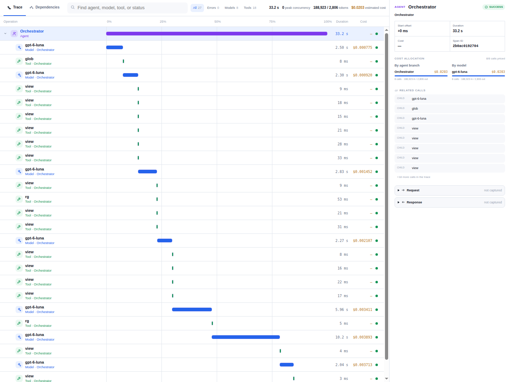

# 5. 变更影响分析、故障根因诊断与 Agent 策略评测

[指南目录](../README.md) · [English](../en/05-engineering-judgment.md) ·
[上一章：部署、运行与维护](04-deploy-operate.md) · [下一章：演示演练与团队落地](06-workshop.md)

前几章系统讲解了一个完整特性的交付闭环。本章转向**工程判断方法论专题**，深入探讨现代软件工程中三个更为核心的技术难题：如何借助 AI 穷尽一个微小改动所引发的连带影响？如何让模型科学定位故障究竟发生在系统哪一层？以及如何用严密的基准设计公平评估不同的 Agent 策略？

本章专注于评测设计、判定器（Oracle）构建与度量评估的方法论框架。具体实验的客观运行数据请查阅演示仓库中的对应工程留痕。

## 5.1 为什么必须建立独立的工程实验靶场？

在开展工程评测与策略对比时，通常需要高频度、主动地向系统中注入各种边界故障，并对多种生成补丁进行反复对比。这类破坏性测试绝不适宜直接在已通过验收的业务应用（如 IT 服务台）中进行。
为此，本体系专门设计了独立的[工程实验应用 (Engineering Lab)](../../../../demos/engineering-lab)：
一个基于 Node.js 24 原生实现的零依赖轻量级工单应用，拥有完全独立的依赖清单与自动化测试套件。[配套实验工具包](../../../../tools/engineering-demo/README.md)在源码工作目录外部以严格受限的沙箱方式运行。

工程实验应用特意保留了未实现“代理负责人（Proxy Owner）”的初始基线状态，以确保不同策略在不同轮次的实验中均能面对完全相同、干净的初始输入。实验生成的候选补丁代码与业务应用的主干代码严格物理隔离。

## 5.2 变更影响分析：新加一个字段，到底会牵动哪些系统边界？

以在工单系统中引入“临时代理人（Proxy Owner）”为例，业务核心不变量是：临时代理人绝不能覆盖承担最终责任的原负责人：

```text
effectiveOwner = proxyOwner ?? owner ?? null
```

在工程实践中，绝非仅仅在 API 返回的 JSON 中随手加一个字段就能宣告完成。架构师必须系统化审视：数据在底层如何持久化？表结构如何平滑迁移？多维检索逻辑如何重构？现有调用方是否会出现静默故障？

| 涉及架构层面 | 必须深入推敲的关键问题 | 独立判定器（Oracle）核验点 |
|---|---|---|
| **核心领域逻辑** | 存在代理人时优先作为有效负责人；原责任人保持不变；检索仍与其他条件按 AND 组合 | 覆盖“有代理”、“无代理”、“完全未分配”与多维交集筛选场景 |
| **底层持久化** | 数据库追加可为空的 `proxy_owner` 字段；迁移脚本必须是幂等且只追加的 | 针对老表结构执行平滑升级、原有数据行与字段完整无损、数据库重启后可可靠还原 |
| **变更接口 API** | `assignProxy(id, proxyOwner)` 严格校验参数类型与 ID 范围 | 越界与非法输入严禁产生脏写入；传 null 能够幂等清空代理人 |
| **数据序列化** | 严格保留既有字段命名，追加序列化输出 `proxyOwner` 与 `effectiveOwner` | 返回值完全符合字段约定，包括显式声明的 null 属性 |
| **契约文档与向下兼容** | 同步更新关于行为边界、参数校验与数据迁移的契约文档 | 文档与代码保持一致，且存量测试用例与历史调用方行为完全不受破坏 |


在整个评测链条中，评测框架会完整留存精确的源码引用、绑定方案内容哈希的审批凭据、实际修改的文件范围以及独立判定器的验证数据。审批凭据中应真实说明是否经过独立第三方的同行审查，坚决杜绝把操作人员本地点击确认粉饰为独立的架构审批。

评测框架在工具设计上严格区分**影响范围**与**修改权限**：影响分析可以广泛引用系统各处的代码上下文甚至无需变动的上游调用方，但“分析涉及某文件”绝不等于“授予了修改该文件的权限”。

**工程实践金句**：一份高质量的变更影响分析，不仅要巨细靡遗地列出“打算修改什么”，更必须明确划定“哪些既有系统行为必须绝对保持未变”。

## 5.3 故障归因分析：精准区分业务代码、测试套件与环境配置故障

评测框架从相同的代码基线分别衍生出三个独立的测试样本，分别受控注入一类典型故障：

| 故障测试样本 | 主动注入的典型故障现场 | 正确的处置策略 | 常见但错误的“作弊捷径” |
|---|---|---|---|
| **业务代码故障 (Product)** | 工单负责人与状态的筛选逻辑由 AND 错误写成了 OR | 修正业务代码中的布尔组合条件 | 错误放宽测试用例断言的预期返回集合 |
| **测试治具故障 (Test-harness)** | 测试用例断言中错误期望了错误的模拟人员 | 将测试断言修正为符合契约的预期值 | 倒逼修改原本正确的业务代码去迁就错误的测试 |
| **环境配置故障 (Environment)** | SQLite 数据库路径被错误配置在 `/dev/null` 目录下 | 修正运行时配置文件中的路径参数 | 盲目重写底层存储连接逻辑或死循环重试 |

在评测中，Agent 会获得真实的测试报错堆栈与相关代码文件，但**对预设的标准分类标签与独立判定器（Oracle）的实现逻辑完全不可见（零信息泄漏）**。模型必须自主分析上下文，输出规范的故障归因分类、推导理由与最小修复代码。
路径白名单适配器会严格限制其可改动的文件范围；生成的代码只能在非 root、彻底断网、只读工作区与严密受限的 Docker 容器中编译运行，临时存储在验证结束后即刻销毁。

在开展对比实验前，必须首先在工程层面确认 CLI 能够精确传递输入、捕获输出并执行受控限制：

- 采用原始结构化事件（JSONL）进行无损解析，避免普通终端自动换行折行导致 JSON 字符串解析破坏。
- 在实测的 CLI 版本中，传入空的 `--available-tools=` 参数**并不能真正禁用工具**；必须在底层配置中显式排除工具集，并通过遥测日志严格断言可用工具数为零。
- 若遥测字段丢失、捕获到非预期事件流或发生了非法的工具调用请求，直接判定该次尝试违规拦截。
- 容器沙箱的启动准备与执行共享超时时限；演练资源的清理销毁单独计时，且必须在报告成功前彻底完成。

上述防线属于面向实验基准的纵深防御，不替代生产级的容器逃逸防护。每当 CLI 大版本或底层通信协议发生升级，均需重新跑通兼容性资格认证。

## 5.4 科学对比 Agent 策略：相同基准与多维客观度量

在同一套标准化基准下，可以深入评估两套经典的策略范式：

- **直接策略 (Direct)**：单次调用，要求模型同时输出故障归因分析与最终修复补丁。
- **先诊断策略 (Diagnose-First)**：首轮调用要求模型仅输出深入的归因诊断与理由；在第 2 轮调用中将该诊断作为上下文，提示模型生成针对性修复补丁。

需要明确的是：同个模型发起的 2 次级联调用，绝不等同于由两个独立评审者开展的双重把关。
在对比评测前，必须提前固定单次调用的超时时间与总体调用预算，在多个样本间交替执行顺序，使用相同的内容 Hash、相同的故障注入点与相同的独立判定器，并提前声明是否允许重试或人工介入修补。调用上限相同，绝不代表实际消耗的 Token 数量或物理耗时一致。

每次运行均必须独立、完整地记录：代码修复是否正确、归因依据是否严谨、是否严守改动文件边界、实际调用次数、Token 消耗、物理耗时与可审计的计费单元。未知的财务成本必须如实标注为未知，严禁随意填零或臆造折算。一旦对 Prompt 模板或校验逻辑进行调整，必须全量重新跑通基准测试，方可客观评判策略是否取得实质改善。

为了避免将不同维度的工程表现混为一谈，评测工具必须将以下指标正交解耦记录：

| 评测度量指标 | 严谨的工程定义与边界 |
|---|---|
| `repairsVerified` | 修复补丁通过了功能测试与独立判定器的行为检验（功能级正确） |
| `evidenceAccepted` | 诊断归因与推导依据完全符合契约规范（认知级正确） |
| `unacceptedCompletionClaims` | 模型声称已完成修复，但未完全通过关卡验收（包含标签分类偏差） |
| `falseCompletionClaims` | 模型声称已完成修复，但代码在独立行为测试中依然报错失败（虚假完成） |

**代码修复正确但归因标签出现偏差，绝不等同于虚假宣称修复成功。**
实验报告必须如实披露样本规模与失败细节；在小样本集上的单次测试，不足以在统计学意义上得出“某种策略必然优于另一种策略”的绝对结论。

## 5.5 全景透视调用追踪（Trace）：洞察过程，但绝不替代结果核验

[](https://huangyingting/github.io/ai-native-sdlc/viewer/?run=36092002982)

**图 G：Agent 真实调用链路追踪详情**（截取自[直接执行基线示例](https://huangyingting.github.io/ai-native-sdlc/viewer/?run=36092002982)，记录于 2026 年 10 月 12 日）。请注意：界面中计算的费用属于基于公开定价模型的估算参考，绝非官方结算账单，亦不可用于强行补全其他未知实验中的财务数据。

在阅读与分析大模型调用链路追踪时，建议遵循以下专业分析步骤：

1. **核验实际调用的模型基底**：确认物理运行的模型名称，而非仅看前端提示词中声明的期望模型。
2. **理清多层级拓扑关系**：系统化审视主编排器（Orchestrator）、底层模型、工具调用（Tool Calls）以及衍生子 Agent 之间的调用时序。
3. **辨别真正的并行执行能力**：核验多个子任务分支在物理时钟上是否存在真实的时间重叠，切勿单纯只看发起了多少个 Agent。
4. **结合业务上下文复盘局部异常**：分析偶发的工具报错是否在后续步骤中被重试逻辑平稳自愈。
5. **严密核算 Token 用量与缓存**：准确区分输入 Token、输出 Token 与缓存读取 Token，坚决杜绝把作为输入子集的缓存 Token 重复相加。
6. **最终回归业务交付本质**：追踪图谱再精美，最终仍必须回答——我们还需要设计哪些独立测试与业务操作，才能确凿证明交付的代码具备生产可靠性？

[Copilot CLI Agent 编排模式指南](../../copilot-cli-agent-orchestration-patterns.md)
系统梳理了直接执行、并行委派、评审后修订（Critic-Revision）与顺序流水线四种经典范式。引入 Critic Agent 确实能有效挑战方案中的脆弱假设，但必须牢记：**让 AI 自我复核一次，绝不能替代基于真实运行时环境的独立测试验证。**

### 开展工程评测前的前置清单设计

在正式启动任何评测实验前，技术团队应至少明确以下规范：

- 固定的代码基线提交 SHA、标准化的故障注入案例、受限改动文件边界与黑盒独立判定器。
- 明确固定的实验策略与模型基底，并在执行后如实记录真实调用的物理模型。
- 设定严格的模型调用上限、单次超时时限、重试规则以及人工干预的登记规范。
- 对功能正确性、既有回归表现、归因证据质量与改动文件边界分别确立独立的评分准则。
- 制定统一的 Token 用量统计口径、异常遥测处置原则与环境开销记录标准。
- 明确界定测试样本的局限性，客观陈述实验数据所能支撑的技术结论边界。

所有运行尝试均必须如实留存审计归档。成本未知时必须坦诚标记为未知，切勿随意折算；对于经历多轮重试才跑通的用例，必须如实披露重试轮次。

[下一章：如何向团队宣讲、从零复现并平稳落地 AI 原生交付范式](06-workshop.md)。
