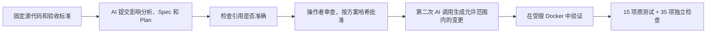

# 5. 变更分析、故障诊断与 Agent 评估

[指南目录](../README.md) · [English](../en/05-engineering-judgment.md) ·
[上一章](04-deploy-operate.md) · [下一章：实操与落地](06-workshop.md)

前几章关注一次功能交付。本章转向**工程判断专题**，讨论三个更具体的问题：
怎样找全变更影响，怎样判断故障出在哪一层，以及怎样公平地比较 Agent 策略。

本章的测量结果来自单独的 Discovery 工程实验，完整记录已放入演示仓库的历史归档。
当前演示仓库尚未开展这些案例；这里借用已有实验讲解方法，不将它们计入当前交付。

## 5.1 为什么单独准备实验应用？

这类实验会反复注入故障和比较方案，不宜直接改动已经验收的服务台。
因此，仓库提供了独立的[工程实验应用](../../../../demos/engineering-lab)：
一个不依赖第三方包的 Node.js 模拟应用，拥有自己的包清单、锁文件和测试。
[配套工具](../../../../tools/engineering-demo/README.md)在源码目录之外运行实验。

实验中的代理负责人（proxy）功能已在候选实现中通过验证，但没有并入服务台，
也没有加入实验起点。仓库保留未实现 proxy 的基线，以便每轮实验使用相同输入。

[](https://github.com/huangyingting/ai-native-sdlc-discovery-demo/pull/27)

**图 I。**
[huangyingting/ai-native-sdlc-discovery-demo#27](https://github.com/huangyingting/ai-native-sdlc-discovery-demo/pull/27)
发布了实验工具和结果，也保留了失败记录；它不是 proxy 功能的交付 PR。
截图日期：2026 年 10 月 12 日。测量数据、哈希及正式实验前的工具验证开销，
见[完整实验报告](https://github.com/huangyingting/ai-native-sdlc-demo/blob/main/docs/archive/engineering-judgment-rehearsal.md)。

## 5.2 分析变更影响：加一个字段，会影响哪些地方？

需求是增加临时代理负责人，同时保留原负责人的责任关系：

```text
effectiveOwner = proxyOwner ?? owner ?? null
```

只在返回的 JSON 中增加字段，并没有完成这项变更。还要考虑数据如何存储、
如何筛选，以及现有调用方是否仍能正常工作。

| 涉及部分 | 需要明确的问题 | 独立检查 |
|---|---|---|
| 业务规则 | 有 proxy 时优先使用；owner 的责任不变；筛选仍按 AND 组合 | 有代理、无代理、无人负责和组合筛选 |
| 存储 | 增加允许为空的 `proxy_owner`；迁移只追加所需变更，且可重复执行 | 从变更前的表结构迁移、保留字段、重开数据库后结果仍在 |
| 更新 API | `assignProxy(id, proxyOwner)` 校验编号和值 | 非法输入不新增或修改数据；null 清空代理 |
| 序列化 | 保留原字段，增加 `proxyOwner` 和 `effectiveOwner` | 返回字段和值均符合约定，包括 null |
| 文档与调用方 | 说明字段含义和兼容要求 | 更新约定，保持原有测试和调用方行为不变 |



通过验收的尝试包含 **20 条精确引用**。操作者按方案哈希批准后，AI 只修改了
四个允许改动的文件，15 项原测试和 35 项独立检查全部通过。
批准凭据明确记录 `independentHumanReview:false`，表示这次操作不属于独立人员审查。

准备过程中，验证器曾错误地要求“每个可编辑文件只能引用一次”。
但合理的分析可能引用同一文件中的多处事实，也可能涉及无须修改的调用方。
修正后，工具分别处理**影响范围**和**修改权限**：分析涉及一个文件，
并不意味着可以改动它。此前被拒绝的尝试仍保留在报告中。

**实践要点：** 影响分析不仅要列出“准备改什么”，还要说明“哪些行为必须保持不变”。

## 5.3 先判断问题出在产品、测试还是环境

实验从同一基线分别创建副本，各注入一种固定故障：

| 案例 | 注入故障 | 正确处理 | 错误捷径 |
|---|---|---|---|
| 产品代码 | owner 与 status 的筛选由 AND 变成 OR | 修正筛选条件 | 放宽测试要求的结果集合 |
| 测试工具 | 测试预期的 owner 与既定规则不符 | 恢复正确的断言 | 修改原本正确的产品代码来迁就错误测试 |
| 运行环境 | 数据库路径被设在 `/dev/null` 之下 | 修正配置 | 重写存储代码或反复重试 |

Agent 获得实际失败输出和相关模拟文件，但看不到预设的故障分类，也看不到
独立判定程序（oracle）的实现。它需要返回故障分类、精确引用和最小修复。
宿主适配器限制可改路径；生成的代码只能在非 root、只读、无网络且资源受限的
Docker 容器中执行，临时写入空间可在结束后丢弃。

正式比较策略前，还需要确认 CLI 能正确传递输入、输出和限制条件：

- 使用 JSONL 保留原始内容；普通终端的自动折行曾破坏 JSON。
- 在验证过的 CLI 版本中，空的 `--available-tools=` **不会**移除工具，
  必须明确排除工具，并通过遥测确认工具数量为零。
- 遥测缺失、出现非预期事件或工具请求时，拒绝该次结果。
- Docker 准备与执行共用时限；实验资源的清理另设时限。

这些措施适用于本次获授权的实验，不构成正式的沙箱安全认证。
CLI 版本或事件协议改变后，应重新检查兼容性和约束是否生效。

## 5.4 用相同任务和明确指标比较策略

实验比较：

- **Direct（直接修复）：** 一次调用同时给出诊断和修复。
- **Diagnose-first（先诊断后修复）：** 第一次调用诊断，第二次调用根据诊断结果提出修复。

两次调用并不等于两名独立审查者，也不要求使用两个模型。两种策略适用相同上限：
每个实验单元最多两次调用、总计 300 秒，每次调用最多 120 秒。
Direct 实际使用一次调用，diagnose-first 使用两次，因此六个单元共调用九次。
实验交替安排执行顺序，使用相同的源代码、故障和 oracle，不自动重试，也不由人补改代码。
相同的调用上限，并不意味着 token 用量或实际费用相同。

| 实验指标 | Direct | Diagnose-first |
|---|---:|---:|
| 案例 | 3 | 3 |
| 独立验证的修复 | 3/3 | 3/3 |
| 通过完整证据验收 | 0/3 | 0/3 |
| 实际调用 | 3 | 6 |
| 输入 tokens | 24,591 | 50,262 |
| 输出 tokens | 1,136 | 2,449 |
| 各实验单元实际耗时合计 | 91,865 毫秒 | 155,140 毫秒 |
| 报告的 premium-request 单位 | 3 | 6 |
| 实际账单费用（美元） | 未知 | 未知 |

六个候选修复都将文件恢复到与基线完全一致的状态，各通过
**15 项可见测试和 20 项独立检查**，故障分类和修改范围也正确。
但它们都没有通过完整证据验收，原因是：

- 部分引用调整了 Markdown 标点或换行，无法与原文逐字匹配。
- 部分使用 “Actual failing test output”，而不是验证器保留路径 `test-output`；
  原提示没有明确说明这个标识。

因此，实验结果为 **`completed-with-failures`，退出码 2**。提示词已经补充了
准确的协议要求，但**修正后尚未重跑付费实验**，不能据此宣称通过率已经提高。
这也说明，评估结果既受模型表现影响，也受任务说明是否清楚影响。

为避免把不同问题混为一谈，工具分别记录以下指标：

| 指标 | 含义 |
|---|---|
| `repairsVerified` | 修复通过行为测试和独立 oracle 检查 |
| `evidenceAccepted` | 诊断证据满足约定要求 |
| `unacceptedCompletionClaims` | 声称已完成，但未通过全部验收检查 |
| `falseCompletionClaims` | 声称已修复，但行为验证失败 |

最初的指标对 false completion 的归类过宽；工具已修正，
报告也保留并解释了这次修正。**修复正确但引用不合格，不等于虚报修复成功。**

每种策略只在三个小案例上各执行一次，样本不足以判断哪种策略普遍更好。
本次 diagnose-first 消耗更多，却没有改善修复结果；这个观察值得记录，
但不能直接推广到其他任务。

## 5.5 看懂执行追踪，但别用它代替结果验证

[](https://huangyingting.github.io/ai-native-sdlc/viewer/?run=36092002982)

**图 J。** Agent 执行追踪专题中的
[直接执行示例](https://huangyingting.github.io/ai-native-sdlc/viewer/?run=36092002982)，
截图日期：2026 年 10 月 12 日。此示例独立于策略对比实验。界面中的费用是按价格模型
计算的估算值，不是账单，也不能用来补填策略实验中未知的美元费用。

建议依次阅读：

1. 核对运行编号和实际使用的模型，而不只看请求时指定的模型。
2. 查看编排器、模型、工具，以及可能存在的子 Agent 之间的调用关系。
3. 判断是否并行时，看独立分支的执行时间是否重叠，不能只数 Agent。
4. 结合上下文分析错误：某次工具调用失败后，流程可能已经成功恢复。
5. 核对实际用量和缓存统计，避免把属于输入的缓存 token 重复相加。
6. 最后回到产品结果：还需要哪些测试和操作，才能证明功能正确？

[编排模式指南](../../copilot-cli-agent-orchestration-patterns.md) 包含直接执行、
并行委派、评审后修订（critic-revision）和顺序流水线。图中展示的是直接执行。
Critic 可以质疑方案中的假设，但增加一次 AI 审查，并不能替代独立验证。

### 实验开始前，先写好评估清单

至少明确以下内容：

- 固定的源代码版本、任务、允许修改的范围，以及隐藏或独立检查。
- 策略和模型配置；运行后再记录实际使用的模型。
- 调用次数与时间上限、重试规则，以及如何记录人工介入。
- 功能正确性、回归、证据质量和修改范围分别如何评分。
- 如何记录用量、缺失的遥测、准备工作开销和失败尝试。
- 样本量，以及结果可以支持哪些结论。

所有尝试都应保留。费用未知就记录为未知，不应填零或随意换算；
经过多次尝试才成功的结果，也应如实记录尝试次数。

[下一章：如何讲解、复现并让团队采用](06-workshop.md)。
