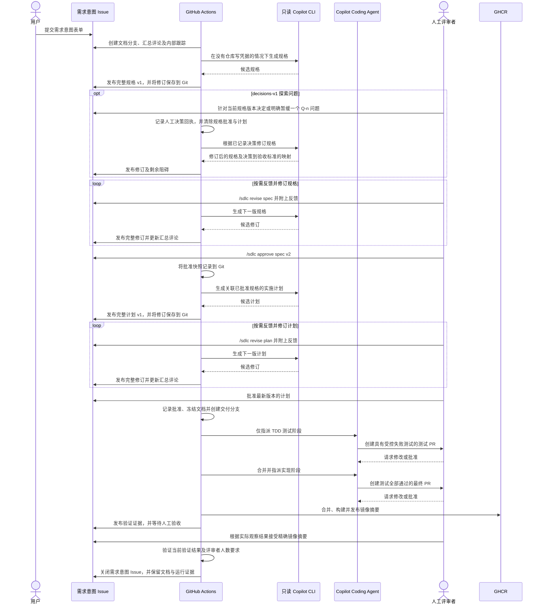

<a id="brownfield-human-gated-delivery-demo"></a>
# 既有系统的人工把关交付演示

[English](brownfield-human-gated-delivery.en.md)

如果要动手演练，请按[分步演练指南](brownfield-human-gated-delivery-walkthrough.md)操作。
本页是环境配置、策略与实现的参考文档。
[图解案例](https://github.com/huangyingting/ai-native-sdlc-demo/blob/main/docs/cases/ownership.zh-CN.md)
将这套设计与当前已验收的工单负责人功能交付联系起来，涵盖截图、评审迭代、发布故障恢复，以及与具体版本绑定的证据。
演示仓库维护案例记录，本仓库维护可复用的指南。
有关当前 Intent/Spec/Plan 体验的局限，以及以决策为中心的演进提案，请参阅
[早期阶段研究与改进设计](../research/ai-native-sdlc-early-stage-research.md)。
其中第一部分探索与决策能力已实现，下文会说明；其余仍是提案。本地已实现，并不意味着已部署到远程仓库。

本演示以现有 IT 服务台为基础，从人工撰写的意图（Intent）出发，依次形成经过评审的规格（Spec）、实施计划（Plan）、可执行测试、可用的功能增量、经过验证的容器镜像，最后取得明确的人工验收，在安全边界内演进既有系统。

```text
Human Intent -> AI Spec <-> Human review and revision
                        <-> Discovery questions / Human decisions (new profile)
             -> AI Plan <-> Human review and revision
             -> TDD Red review -> Implementation Green review
             -> Build -> Smoke verification -> Human acceptance
```

每一次设计与代码阶段的推进，都必须在 GitHub 网页界面中获得人工批准。
GitHub Actions 记录文档批准，并协调受保护的 PR 阶段；Copilot 绝不能批准自己的工作，也不能绕过分支规则。
Intent 由人在 GitHub Issue 中撰写；流程没有 AI 代写 Intent 的阶段，也没有额外的 Intent 批准关卡。
对于**新的 Intent**，AI 会在同一个父 Issue 中，以完整渲染的 Markdown 修订评论提交 Spec 和 Plan。
评审者在这里讨论、明确要求修订或批准具体版本，然后才进入 Tests 和 Implementation PR 阶段。

**兼容性：**所有基于 Issue 的运行（`issue-v1`）都需要人工验收，包括本次升级前已启动的 Issue 运行。
只有[旧版 Spec/Plan PR 运行](#legacy-specplan-pr-mode)仍在冒烟验证成功后自动关闭；这些运行不会迁移为 Issue 评审。
不能仅凭分支是否存在判断运行模式，因为基于 Issue 的运行在工程交接时也会创建工程分支。
使用前，新工作流必须已存在于远程默认分支，且已完成注册；仅修改这些文档并不会部署工作流。

**探索模式兼容性：**源配置中的 `specReadiness: "decisions-v1"` 会让新初始化的 Issue 运行采用第 2 版文档状态。
它仍使用 `issue-v1` 的 Issue/PR 传递机制，并非一种新的 PR 生命周期。
未配置 `specReadiness` 或将其设为 `"structural"` 时，仍启动原有的第 1 版结构性评审。
修改配置不会改变已有运行的模式；不支持的模式会明确报错。
请将整套受信任模块、提示词和工具包一起升级；旧代码无法读取第 2 版状态。

<a id="lifecycle"></a>
## 生命周期



新的文档评审使用 `brownfield-documents/<intent-number>`。
只有 Plan 获得全部必需批准后，自动化才会**从已批准的文档提交**创建
`brownfield-delivery/<intent-number>`，关闭内部 Spec/Plan 阶段 Issue，并且只将 TDD Tests 分配给 Coding Agent。
四个阶段 Issue 可以继续用于内部跟踪，但进入测试前，人的主要评审界面是父 Intent，而不是这些内部 Issue 或文档 PR。

Tests PR 合并到交付分支。Implementation PR 从该分支开始，并由自动化将目标分支改为 `main`。
因此，最终 PR 包含完整的、已经评审的功能增量，包括已批准的文档与批准状态 blob。

<a id="review-artifacts"></a>
## 评审产物

请通过父 Intent 当前的汇总评论查找最新 Spec、Plan、版本号及批准状态。
每次发布的修订都是完整渲染的 Markdown 评论，而不只是差异、摘要或文件链接。
修订历史、普通讨论和人工命令都保留在同一个 Issue 上。除方便阅读的评论外，Git 快照还提供持久证据。
检查清单只是提醒，不是批准机制。

每个新生命周期都会在 `brownfield-documents/<intent-number>` 上保存以下文件：

```text
docs/delivery-runs/brownfield-human-gated-delivery/<intent-number>/
  spec.md
  plan.md
  document-review.json
```

- `spec.md` 包含范围、非目标、约束，以及带有 `AC-1` 等稳定编号的 Given/When/Then 场景。
- `plan.md` 将工作拆解为稳定的任务 ID、依赖关系、受影响部分、验证方法及验收映射，并链接到已批准的 Spec。
- `document-review.json` 记录文档版本、哈希、已处理命令、批准快照和交接状态。
  第 2 版还记录固定的就绪模式、问题登记表、不可变的人工决策回执，以及与批准绑定的决策上下文哈希。

每次修订和批准都保存到 Git。批准快照记录文档版本与哈希、批准命令评论的 ID 与正文，以及批准人的 ID、登录名和批准时间。
它**不会**另行保存一份不可变的、已渲染修订评论的 ID 与正文快照。
编辑或删除**已处理**的批准评论，并不会撤销已记录的决定。
如需在交接前更改已批准的文档，应明确提交修订命令，不要试图通过修改旧评论来撤销批准。

每个源状态提交还会在父 Issue 的同一条可折叠审计账本评论中留下摘要条目；该评论由受信任的 `github-actions[bot]` 自动化维护。
批准来源会与该账本核对，因此直接在 Git 中修改 `document-review.json` 无法冒充人工批准。
不要通过编辑或删除账本来改变评审决定。

Tests 阶段随后会在交付分支的同一产物目录中添加 `expected-failures.json`，列出实现前预期处于 Red 状态的精确可执行测试。

这些文件是受版本控制的证据。后续阶段可以使用它们，但不能悄悄改写已经获人工批准的产物。
TDD Tests 和 Implementation 必须保留已批准的 `spec.md`、`plan.md`、`document-review.json` 的**完全相同的 Git blob**，仅仅保持文字含义相同还不够。
Implementation 还必须保留生命周期分支上每个已批准测试文件的 Git blob。
如需补充测试，请放在**新文件**中；不得编辑、删除、重命名或削弱已批准的测试，即使测试名称保持不变也不行。

<a id="trusted-operational-run-record"></a>
### 受信任的运行记录

基于 Issue 的运行还会在独立的 `brownfield-runs/<intent-number>` 分支中保存
`docs/delivery-runs/brownfield-human-gated-delivery/<intent-number>/run-state.json`。
这份可变记录跟踪运行控制、交付验证和人工验收，而不改动工程 PR 继承的已封存文档 JSON。

只有受信任的自动化可以写入该记录，源状态摘要由 Intent 上的工作流机器人账本证明。
直接修改 Git 并不构成经过认证的控制命令或验收决定。请完整保留记录及账本。
`brownfield-documents/**` 与 `brownfield-runs/**` 都会保留供回放使用；
只有工程分支 `brownfield-delivery/<intent-number>` 可在人工验收后清理。取消运行会保留所有分支。
缺少必需且经过证明的文档分支或运行分支时，系统会明确失败。
恢复操作不会悄悄重建一套历史，也不会重置已经记录的批准。

<a id="issue-command-contract"></a>
### Issue 命令约定

每条命令都必须由人作为**父 Intent 上一条新的顶层评论**提交，并将命令单独放在第一行。
这些命令是本仓库自定义的 GitHub Actions 命令，**不是内置的 `@copilot` 命令**：

```text
/sdlc revise spec
<feedback describing the requested Spec changes>
```

```text
/sdlc revise plan
<feedback describing the requested Plan changes>
```

```text
/sdlc approve spec v2
```

```text
/sdlc approve plan v1
```

请把示例版本号替换为汇总评论显示的最新版本。
普通讨论、“looks good”之类的表示、修改检查清单以及机器人评论，都不会执行 AI，也不会批准阶段。
编辑旧评论不算新提交。修订命令必须附带反馈；
如仅需恢复文档生成或交接，请使用不附带反馈的 `/sdlc retry`。
它不是工程 CI、Advance 或 Publish 的重试命令。

<a id="discovery-and-decision-readiness"></a>
### 探索问题与决策就绪

新的 `decisions-v1` 运行会在 Spec 中包含一个 `Discovery` JSON 部分：
问题、证据或未知信息、可观察的成功标准、备选方案、编号稳定的 Q-n 问题及选项，以及决策到 AC 的映射。
渲染后的评审材料会展示简报、所有问题状态、最新决策结论或暂缓风险，并链接到完整且受版本控制的人工决策记录。
过长文本会明确标为摘录；与其绑定的产物仍保存全文。

所有列出的问题一开始都会阻止批准。当前具有仓库写权限、且已配置为 Spec 评审者的人，应提交一条新的、未经编辑的评论：

```text
/sdlc decide spec v1 Q-1
Outcome: A ticket may remain unassigned until triage.
Rationale: New requests arrive before responsibility can be assigned.
```

请使用汇总评论中的实际版本与问题编号，不要照抄这些示例 ID。
字段名区分大小写；每个字段占一行、不得为空，最多 4000 个字符。
不要添加额外字段，也不要用代码围栏包住提交的命令。
只有已配置的 Spec 评审者（包括已配置团队的当前成员）可以作出决策。
仅仅是 Intent 作者或暂缓事项的跟进负责人，并不会获得这项权限。最终批准仍需达到配置要求的批准人数。

如果某个问题可以安全地延后处理，请明确记录限制：

```text
/sdlc defer spec v1 Q-1
Rationale: This isolated rehearsal does not establish a production policy.
Owner: YOUR-GITHUB-LOGIN
Follow-up: Resolve in a linked Intent before production use.
Risk: The proposed workflow has not been validated with customers.
```

`Owner` 必须是不带 `@` 的 GitHub 登录名。该字段只是记录责任归属，并不发送指派通知，也不能证明负责人已经同意。
提交命令的受信任 Spec 评审者是在明确接受所述风险。
系统没有自动提醒或到期关卡，必须由人跟进。暂缓事项会持续显示为风险，绝不会显示为已解决的问题。

**提交以上任一命令后：**

1. 自动化记录原始命令、操作人、时间、来源 Spec 的版本与哈希、策略哈希及决策上下文哈希。
2. 现有 Spec 批准与 Plan 失效，并自动请求修订 Spec。决策本身不是阶段批准。
3. AI 必须保留所有问题，并将最新决策回执映射到有效的 AC ID；若无需修改 AC，则必须明确说明原因。
4. 阅读新的 Spec 及其映射。针对新版本回答剩余问题；一次提交一条命令，每次都等待修订完成。
5. 所有问题均已解决或明确暂缓后，提交常规的 `/sdlc approve spec vN`。Plan 仍须等全部必需批准到齐后才会生成。

AI 不能通过删除或修改已经登记的问题与选项来规避阻碍，也不能把自己的假设标为已确认，或伪造决策映射。
如果登记的问题有误，应明确处理旧问题，并请求新增正确的问题。
交接前，对已回答问题提交更新的 decide/defer 命令会替代先前答案、保留历史，并再次使批准失效。
编辑或删除已经处理的命令不会撤销它。

Spec 和 Plan 的批准不仅绑定文档哈希，也绑定当前决策上下文。
交接与工程验证会重新检查该契约；现有的精确 blob 规则会保留完整决策记录。
每次运行最多允许 20 个问题、100 份决策回执；超出时应缩小 Intent，而不是悄悄丢弃历史。
生成、持久化或发布出错时会明确报错，可用 `/sdlc retry` 重试；重复处理不能将同一条命令计算两次。
当替代修订仍在生成时，系统不会用较新的决策上下文重建已经失效且评论被删除的旧修订。
其 Git 历史仍会保留；重试会继续生成并发布替代版本，供重新评审。

这是一个以已记录决策为依据的就绪关卡，不是能够判断一切语义的裁判。
即使映射引用有效，AI 仍可能漏掉问题或误用答案。对于本来就明确的 Intent，问题列表可以为空。
人必须审查行为与验收标准。仅针对 Plan 的问题自动化、技术实验、语义差异和评审工作量测量，都不属于本次实现范围。
Plan 与 Spec 冲突时，仍须先明确提交 `/sdlc revise spec`，才能继续。

只有当前已配置、且具有仓库写权限的人（包括已配置团队的当前成员）可以批准，机器人不可以。
批准必须针对最新文档版本，并满足该阶段配置的 `minimumApprovals`。
Issue 批准不是原生 PR 评审：GitHub 针对曾与 Copilot 协作人员的独立评审限制不适用于此；
Intent 作者只要符合配置要求，也可以批准。

**工程交接前**修订 Spec，会使所有 Spec 批准、草稿或已批准的 Plan，以及 Plan 的全部批准失效。
必须重新评审并批准新 Spec，再生成并批准新的 Plan 版本，不能复用旧 Plan 批准。
修订 Plan 同样要求对新 Plan 版本重新批准。
Plan 一旦获得全部批准，文档即冻结并进入工程交接；修订命令不能改写这份已批准的契约。

<a id="run-controls-and-human-acceptance"></a>
### 运行控制与人工验收

对于基于 Issue 的运行，每条命令都必须由人作为**父 Intent 上一条新的、未经编辑的顶层评论**提交。
运行控制要求仓库写权限；仅仅是 Intent 作者并不获得控制权。编辑已提交评论不是新命令。
自动化将决定记录在受信任的运行记录中，而不是已封存的文档状态中。
**Documents** 工作流同时处理运行命令与文档命令；其报告能区分运行控制或清理失败与文档生成失败。

| 命令 | 作用与下一步人工操作 |
|---|---|
| `/sdlc help` | 显示命令约定；选择下一步要明确执行的操作 |
| `/sdlc status` | 报告已记录的进展与阻碍；检查链接的工作流及评审界面 |
| `/sdlc pause` | 暂停后续工作，使 PR 策略保持待定并禁用自动合并；调查清楚后再恢复 |
| `/sdlc resume` | 解除暂停；检查当前状态，必要时另行恢复失败的 Actions |
| `/sdlc cancel` | 终止运行且不可恢复；保留 Issue、PR、分支与证据，如需继续则创建新 Intent |

暂停和取消**不会终止已经运行的代理或工作流，不会撤销合并，也不会回滚已发布镜像**。
受信任的自动化同步状态时，会据此阻止后续文档发布、发布结果处理及阶段推进；它们不是即时紧急停止按钮。
恢复运行不会自动重试失败的工程作业。

Publish 验证成功后，已配置的 Implementation 评审者应使用**这一个经过验证的镜像**，按已批准的验收场景实际操作，然后提交以下任一命令：

```text
/sdlc accept sha256:<64hex>
<Actual observed results, including scenarios exercised and any limitations.>
```

```text
/sdlc reject sha256:<64hex>
<Actual observed failure and the affected acceptance scenario.>
```

将 `<64hex>` 替换为已发布摘要中的 64 个小写十六进制字符；不得提交占位符，也不得声称执行了实际未做的测试。
验收使用 **Implementation** 的评审者策略和 `minimumApprovals`，不是一个新的阶段选择项。
每位符合条件的人都必须自行提交决定。
命令必须在成功验证结果发布之后提交，并与当前镜像摘要一致；
保存的决定会把该摘要与合并 SHA、Actions 运行 ID 和尝试次数绑定。旧命令不能预先批准未来的验证。

运行完成前，重新验证会使已收集的验收决定失效，即使镜像摘要没有改变。
拒绝验收会阻止后续验收，直到进行另一次验证尝试；仅追加接受评论不能消除拒绝记录。
基础设施故障可在修复原因后重新验证。合并后发现的代码或范围缺陷必须通过**关联的新 Intent**修复，
而不能编辑已封存的文档或已批准的测试。请保留被拒绝运行的证据，不要伪装成通过。
已验收完成的运行处于终态；再次交付必须创建新的 Intent。

自动冒烟检查成功不等于人工验收。
只有当前符合条件的人数达到配置要求、并接受经过验证的结果，才会关闭基于 Issue 的 Intent 并移除其工程分支。
仍在执行的旧版文档 PR 运行保留原有完成方式，不会追溯迁移。

<a id="one-time-repository-setup"></a>
## 仓库的一次性配置

首次运行前，请先完成演练指南中的[按顺序准备仓库](brownfield-human-gated-delivery-walkthrough.md#1-prepare-the-repository)步骤，
其中包括选择源版本、导出隔离副本、检查与发布。
本节详细说明如何配置准备好的仓库，不能替代上述初始化步骤。

<a id="run-the-setup-script"></a>
### 运行配置脚本

在仓库根目录使用无额外依赖的 [`setup.mjs`](../../.github/brownfield-human-gated-delivery/scripts/setup.mjs)。
它面向 GitHub.com，要求 Node.js 24+、GitHub CLI（`gh`），以及以**仓库管理员**身份登录的会话。
无需在根目录执行 `npm install`。
现有演示自动化和应用必须已经发布到 `main`，且 `main` 必须是默认分支；
配置脚本不会发布本地代码，也不会更改分支名称。

```sh
gh auth login --hostname github.com

# Read-only preview, including configured reviewers and missing prerequisites.
npm run setup:brownfield -- --repo OWNER/NEW_DEMO_REPO

# Only with agreement to all previewed changes, preferably in an isolated repo:
npm run setup:brownfield -- --repo OWNER/NEW_DEMO_REPO --apply
```

将 `OWNER/NEW_DEMO_REPO` 替换为你明确选定的隔离仓库。
如果准备时选择了单人模式，每一条 setup 命令都必须包含 `--single-owner`，包括下方的令牌配置及修复示例。
显式指定仓库可以防止误改另一个远程仓库。
管理员的 CLI 凭据需要有权管理仓库设置与规则集、Actions 设置与机密、Environment 和 Issue。
它与下文的受限自动化 PAT **相互独立**；不要仅为了运行 setup 而授予那个 PAT 管理员权限。

**重要：**完整执行 `--apply` 会创建缺失的受管理规则集，包括为当前未受保护的 `main` 添加保护。
请检查选定目标仓库的实际保护配置；不能因为这份通用指南存放在某个仓库，就推断该仓库没有保护。
源仓库 `huangyingting/ai-native-sdlc` 的 `main` 是有意保持不受保护的；
没有明确同意改变该策略前，不要在那里执行 apply。
`--apply --set-token`、`--apply --intent` 和 `--single-owner --apply` 也一样：
它们不是只写入单个设置、跳过其余配置的局部操作。预览模式绝不写入。

脚本会：

- 验证配置、Issue 表单、提示词、验证器、工作流、应用清单及 Dockerfile 都存在于 `main`，
  包括 `brownfield-human-gated-delivery-documents.yml`（**Brownfield Delivery · Documents**），
  以及 `.github/brownfield-human-gated-delivery/scripts/` 下受信任的 `runs.mjs`、`run-core.mjs` 和 `state-store.mjs` 模块；
- 启用 Issue、自动合并、配置的合并方式及 GitHub Actions；
- 检查已有工作流的注册状态，启用被禁用的交付工作流和 IT 服务台 CI，不改动无关工作流；它无法注册缺失的 Actions 工作流；
- 在缺失时创建 Intent 标签和临时验证 Environment；
- 仅为 `main` 与 `brownfield-delivery/**` 配置受管理规则集，
  将必需检查绑定到已验证的 GitHub Actions 应用身份，不设置任何绕过规则的主体；完整 apply 会创建缺失的 `main` 保护；
- 检查各个人工评审者是否具有仓库写权限、Copilot Bot 是否可被指派，以及自动化机密的**名称**是否存在，绝不读取其保存的值。

默认情况下，脚本绝不覆盖已有规则集及 Environment 保护。已符合要求且更严格的规则会保留。
下文说明的显式 `--single-owner` 模式，只会改变现有同名规则集中的原生批准数量。
这些规则集的其他冲突会在任何写入前阻止配置；请到 GitHub 设置中解决冲突后重跑。
其他规则集、继承的规则集及传统分支保护可能施加额外检查，或阻止生命周期分支的创建与删除；请人工检查。
配置脚本不会授予绕过权限，也不会放宽组织策略。

文档分支与运行记录分支必须允许受信任的自动化写入；它们既不会加入受管理的 PR 规则集，也不会获得绕过权限。
请检查是否有组织级规则集阻止这些写入。授权任何写入前，都应审阅完整预览。

确认远程默认分支上的 **Actions > Brownfield Delivery · Documents** 已可用。
本地检出目录中有工作流文件，并不能证明远程已注册或部署。
先将经过审查的工作流修改发布到 `main`，等待 GitHub 注册，再重跑配置预览进行核实。
配置脚本不能发布文件，也不能为缺失的工作流创建注册记录。

若要创建或替换自动化机密，先按[下方权限说明](#configure-the-copilot-token)创建 PAT，再使用交互式终端：

```sh
npm run setup:brownfield -- --repo OWNER/NEW_DEMO_REPO --apply --set-token
```

GitHub CLI 会以安全提示方式询问令牌值。
不要把令牌放入命令行参数、文件或聊天中。不加 `--set-token` 时，已有机密不会被改动。
机密存在并不能证明其权限、有效期、选定仓库或 Copilot 使用资格正确。

要为已经创建但缺少标签的 Intent 补上标签：

```sh
npm run setup:brownfield -- --repo OWNER/NEW_DEMO_REPO --apply --intent 7
```

将 `7` 替换为现有 Intent 编号。该 Issue 必须仍然打开，且作者具有授权资格。
此处针对 Intent 的操作只添加标签，**不会**触发 kickoff。
脚本会打印明确的恢复命令，供完成配置和人工检查后执行。

退出码：**0** 表示自动检查通过（仍需完成人工检查），**2** 表示还有预览中的变更或未解决的检查项，**1** 表示错误或冲突。
变更不具备事务性：如果 GitHub 拒绝后续写入，之前成功的更改仍会保留。
修复报告的问题后重跑即可；资源不会重复创建，机密不会被隐式轮换，已应用的设置会在报告成功前重新读取核验。

仍需人工处理的事项包括：账户或组织的 Copilot 访问与计费、PAT 创建与授权、子 Issue 可用性、
GHCR 包发布权限，以及可选的自动 Copilot 评审。
受限的 Actions 允许列表和基于团队的评审策略会被标为未验证（退出码 2）；
脚本不会扩大允许列表，也不会声称已通过机密验证团队成员资格。
请通过经过评审的 `main` 分支变更配置所需人工评审者；setup 从不修改评审者身份。
本地应用安装是可选项，演练指南中有说明。

文档生成还要求 Actions 具有 `copilot-requests: write` 权限、Copilot CLI 使用资格，以及符合适用的组织 CLI 计费策略。
检查指派令牌机密并不能验证这些前提。

<a id="single-owner-demo-mode"></a>
### 单人演示模式

新的 Spec/Plan **Issue 批准不需要这个模式**：GitHub 原生 PR 的独立评审限制不适用于 Issue 评论。
配置中的人工策略与 `minimumApprovals` 仍然适用。
此选项针对 Tests、Implementation PR，以及旧版 Spec/Plan PR。

如果某人曾在某个 PR 上与 Copilot 协作，GitHub 可能不将其批准计入原生必需评审数量，即使此人是仓库所有者。
这与演示配置中的人工批准策略是两套独立机制。请参阅
[GitHub 的 Copilot 评审说明](https://docs.github.com/en/copilot/how-tos/copilot-on-github/use-copilot-agents/review-copilot-output)。
如需独立评审，可添加另一位具有**写权限**的协作者；对方不必是仓库所有者。

只有一位参与者的演示，应明确选择此模式：

```sh
# Preview the single-owner configuration.
npm run setup:brownfield -- --repo OWNER/NEW_DEMO_REPO --single-owner

# Apply and verify it.
npm run setup:brownfield -- --repo OWNER/NEW_DEMO_REPO --single-owner --apply
```

该模式会将 setup 管理或创建的规则集（`main` 和生命周期分支）中的原生 `required_approving_review_count` 设为 **0**。
更新前会重新读取现有规则集，并且只修改这一计数。
分支范围、必需状态检查及其 GitHub Actions 来源、讨论解决要求、禁止强制推送和禁止绕过规则的约束，都会保留。
无关规则集与 Environment 保护不会被改动。
GitHub 针对未归属 Copilot PR 的额外批准设置保持不变；当原生必需批准数为零时，该设置没有作用。

**不要降低交付配置中的 `minimumApprovals`。**
每个 PR 阶段仍必须通过 **Brownfield delivery policy**，获得已配置评审者对当前 head SHA 的明确人工批准。
文档阶段使用最新版本的 Issue 批准快照。
变更请求、过期批准、机器人评审，以及缺失的阶段检查，仍会阻止 PR 推进。
协调器工作流作业成功，不能替代这项必需的策略状态。

这**不是独立的双人评审**。
交付生命周期之外的普通维护 PR，在这些规则集中也会失去原生批准数量下限。
如果仓库要求指挥代理的人和批准工作的人相互独立，请使用默认的独立评审模式。

后续运行 setup 时请继续保留 `--single-owner`。
省略该参数会报告模式冲突，而不是悄悄恢复原生批准下限。
恢复独立评审需要明确编辑规则集。
其他或继承的评审要求仍可能要求另一人参与，此选项不会移除它们。

应用评审规则变更可能解除已获批准且启用自动合并的 PR 的阻碍，从而推进生命周期。
setup 本身不会提交批准或合并 PR。
请确认 Documents 工作流已经发布并注册；仅对生命周期规则集作局部修改，不能证明这一点。
完整 apply 也会创建缺失的 `main` 保护。
只对事先约定的目标仓库执行操作；未经明确同意，不要改变原始源仓库的策略。

<a id="enable-github-features"></a>
### 启用 GitHub 功能

启用以下功能：

- Copilot Coding Agent；
- Actions 中的 Copilot CLI、对应的使用资格与计费策略，以及文档生成所需的 `copilot-requests: write`；
- Issue 和子 Issue；
- PR 自动合并；
- GitHub Actions；
- GitHub Packages 和 GHCR；
- 如果仓库套餐支持，启用自动 Copilot 代码评审。

创建 `it-service-desk-demo` Environment。
它用于记录最终的临时容器验证，不是持久托管环境。

<a id="create-the-intent-label"></a>
### 创建 Intent 标签

使用 Issue 表单前，先创建 `brownfield-human-gated-delivery:intent`。
kickoff 工作流会自动创建内部阶段标签。
GitHub 不会根据 Issue 表单自动创建缺失的标签：Issue 可以在没有该标签的情况下提交，随后 kickoff 会被跳过。
恢复时，应创建标签、将其添加到现有 Intent，并在完成其余配置后，以该 Issue 编号手动运行 **Brownfield Delivery · Kickoff**。
仅添加标签不会触发 kickoff。

<a id="configure-the-copilot-token"></a>
### 配置 Copilot 令牌

创建细粒度用户 PAT 或 GitHub App 用户到服务器令牌，并以 `COPILOT_ASSIGN_TOKEN` 为名称保存。
GitHub 的 Copilot 指派 API 不接受默认的服务器到服务器 `GITHUB_TOKEN`。

细粒度令牌需要：

- metadata：读；
- actions：读写；
- contents：读写；
- issues：读写；
- pull requests：读写；
- organization members：配置组织团队时需要读权限。

该令牌只供受信任的默认分支自动化使用，例如指派 Copilot、解析已配置团队的成员资格、
触发工作流、调整 Implementation PR 的目标分支，以及启用或撤销受保护的自动合并。
调整目标分支时使用此令牌，而不是 `GITHUB_TOKEN`，
因为后者的修改会抑制验证新目标分支所必需的 `pull_request: edited` 事件。
该令牌绝不会暴露给 PR head 工作流。

文档生成**不会**获得此令牌或其他仓库写入凭据。
Copilot CLI 使用独立的 Actions 访问能力，需要 `copilot-requests: write` 及 CLI 使用资格。
受信任的发布和批准步骤在生成边界之外执行 Git 与 Issue 写入。
人在 GitHub 网页上评审不需要令牌。

<a id="configure-human-reviewers"></a>
### 配置人工评审者

编辑 [`config.json`](../../.github/brownfield-human-gated-delivery/config.json)：

```json
{
  "stages": {
    "spec": {
      "minimumApprovals": 1,
      "reviewers": {
        "users": ["huangyingting"],
        "teams": []
      }
    }
  }
}
```

每个阶段都支持 GitHub 用户登录名、组织团队 slug，以及各自的批准门槛。
仓库中的默认配置将 `huangyingting` 指定为 Spec、Plan、Tests 和 Implementation 的评审者，每个阶段要求一次批准。
Intent 作者不会自动成为批准人。
如果本演示要求某位最终用户必须批准 Spec 和 Plan，请将该用户的 GitHub 登录名配置为这些阶段的唯一评审者，
并设置 `minimumApprovals: 1`。
如果评审者池更大，任何符合条件的成员都可以共同达到门槛，并不保证某个特定的人一定批准。

配置从默认分支加载。生成的文档或 PR 无法给自己指定更宽松的评审者，也无法降低自己的批准门槛。

- **Issue 文档：**只有当前已配置、且具有仓库写权限的人才能批准最新版本，
  包括直接配置的用户或已配置团队的当前成员。Intent 作者符合配置条件时可以批准，机器人不可以。
  评论及正文、人的身份与时间、版本和文档哈希共同组成批准快照。
  编辑或删除已处理评论不是撤销机制。
- **PR 阶段（包括旧版 Spec/Plan）：**批准必须来自已配置用户或已配置团队的当前成员，
  针对当前 head SHA，且不得来自 PR 作者或机器人。
  仅评论和待提交的评审不会替代上一次具有决定性的评审。
  撤销评审会使批准失效；已配置评审者尚未解决的变更请求会阻止策略通过。
- **最终验收（所有基于 Issue 的运行）：**使用 Implementation 的评审者及批准人数要求，
  要求人当前具有写权限，并提交与镜像摘要绑定的实际观察结果。
  请明确配置这些评审者；Intent 作者和演示者都不会自动成为批准人。

团队成员资格通过 `COPILOT_ASSIGN_TOKEN` 读取，而不是通过仓库范围的 `GITHUB_TOKEN`。
请确保它能读取已配置的组织团队。

<a id="configure-branch-rulesets"></a>
### 配置分支规则集

为 `brownfield-delivery/**` 和 `main` 创建已启用的规则集；只有这两类分支属于受管理范围。
`brownfield-documents/**` 和 `brownfield-runs/**` 必须允许受信任的自动化不经 PR 保存状态；
不要把它们纳入要求 PR 的交付规则集，也不要授予绕过权限。
请检查更大范围的组织规则是否冲突。
分支保护是管理员需要明确决定的事项：完整 setup `--apply` **确实会**创建缺失的 `main` 保护。
请检查目标仓库的实际策略，获得同意后再应用；不要把准备好的演示仓库和源仓库当成同一个目标。

两类分支都应：

1. 要求通过 PR 修改。
2. 默认至少要求一次批准评审，作为仓库级下限。
   对于[单人演示模式](#single-owner-demo-mode)，只把原生批准数量设为零，保留必需的人工策略状态。
3. 有新提交推送时，撤销过期批准。
4. 要求解决所有讨论。
5. 阻止强制推送。
6. 要求合并前分支保持最新。
7. 不给 Copilot 绕过权限。

禁止删除 `main`。
允许删除 `brownfield-delivery/**`，以便人工验收后移除工程分支（旧版运行仍在冒烟成功后清理）。
对于生命周期分支规则集中的必需状态检查，启用 `do_not_enforce_on_create`（创建分支时不要求状态检查）。
文档交接必须能在任何阶段 PR 存在之前，从已批准的文档提交创建生命周期分支。
旧版 kickoff 从 `main` 创建分支。后续更新与合并仍须通过检查。
不要添加限制生命周期分支创建的规则。

`brownfield-delivery/**` 和 `main` **两者都必须**要求：

- **`Brownfield delivery policy`**——受信任的 PR Coordinator 写入的精确提交状态上下文；将 GitHub Actions 选为预期来源。
- **`stage-validation`**——**Brownfield Delivery · Stage CI** 的汇总作业。

不要用协调器工作流作业成功的结论代替其策略状态。协调器完全可能执行成功，但报告批准人数不足。
同样，不要只依赖单独路由的 `artifact-gate`、`tdd-red` 或 `implementation-contract` 作业：
某个作业被跳过，不代表适用阶段已通过。
元数据分类失败或选中的阶段未成功，都会使汇总检查失败。

`main` 还必须要求：

- 上面两项必需状态或检查；
- `validate`；
- `container-smoke`。

IT 服务台 CI 工作流会在每个 PR 上运行，没有 PR 级路径过滤，
因此无关的文档或工具 PR 也会产生这些必需检查。
新的 Issue 文档评审不运行应用测试、构建或容器冒烟作业，也不等待 PR 状态检查。
Documents 会先验证结构、范围及批准状态，再推进流程。
在旧版生命周期分支上，Spec 和 Plan 会跳过应用的 `validate` 与 `container-smoke`：
其阶段 CI 验证文档和范围，而不是应用代码。
Tests 也跳过常规 Green CI，改用专用的受控 Red 验证。
目标为默认分支的 PR 总会运行真正的 Green 检查，即使其正文中写有 `Delivery Stage: tests`。

| 阶段 | 自动验证 | 人工关卡 |
|---|---|---|
| Spec（新 Intent） | 规格结构、验收场景、文档范围与状态；decisions-v1 还要求人工处理问题并建立决策映射；不构建应用 | 在 Issue 上批准最新 Spec 版本及其决策上下文 |
| Plan（新 Intent） | 任务及依赖结构、验收映射、已批准 Spec 的关联、文档范围与状态；decisions-v1 还保留 Spec 就绪状态及上下文；不构建应用 | 在 Issue 上批准最新 Plan 版本 |
| TDD Tests | Green 基线、可编译的测试变更，以及精确的受控 Red 证据 | 评审并批准测试 |
| Implementation | 不可变契约、Green 测试、lint、构建和容器冒烟检查 | 评审并批准实现 |
| 验收（所有基于 Issue 的运行） | 当前已发布验证、镜像摘要/合并/运行/尝试次数的绑定，以及评审者人数要求 | 实际操作该镜像，并以观察结果确认验收 |

默认模式下，原生评审规则只实施统一的最低要求，**不会**实施配置中的评审者身份要求或更高的阶段门槛。
单人演示模式没有原生批准数量下限，而是通过必需的策略状态实施 PR 阶段的人工批准。
新的 Spec/Plan 批准使用 Issue 文档策略，而不是这些原生 PR 评审规则。
必需的策略状态可防止仅凭较弱的最低要求就进行手动或自动合并。
本演示不得给人或自动化授予绕过规则集的权限。

在 PR 阶段，协调器会在当前 head 上写入 pending/failure/success；
评审策略一旦不再满足，就撤销已有自动合并。
满足批准条件后，它会先在必需策略状态仍为 pending 时启用受保护的自动合并，再发布 success；
它从不直接合并，也不绕过分支规则。
PR 打开、重新打开或关闭、head 同步、正文或目标分支编辑、草稿状态变化、
评审提交/编辑/撤销、阶段 CI 完成，以及默认分支策略配置变更时，它都会重新读取实时 PR 元数据与评审。
这些 GitHub 事件是异步的；请保留原生的过期评审撤销和分支必须最新要求。
协调器串行执行，而且**每个最终得以执行的运行都会重新核对所有打开的 PR**，
因为 GitHub 可能替换并发组中等待执行的运行。
无效 PR 会被标记为失败并撤销自动合并，但不会阻止其他 PR 的核对；
只有处理完整个列表后，运行才会报告累计失败。
提交状态以 **SHA 和上下文**为键，而不是 PR 编号。
协调器会让汇总的 `Brownfield delivery policy` 状态保持 pending，
直到检查完**所有共享该 SHA 的打开 PR**。
所有适用的生命周期策略都通过后才会成功；普通 PR 无法覆盖同 head PR 的失败。
共享 head 获准后，其所有受保护的自动合并请求都会在汇总状态仍为 pending 时启用。
决策或修改操作失败会撤销该共享 head 组的自动合并，其他 head 仍独立核对。
关闭造成阻碍的重复 PR 会触发其余同组 PR 的重新核对。
普通非生命周期 PR 只有在共享 head 上没有生命周期策略阻碍时，才会得到“不适用”的成功状态。
生命周期登记信息保留在 PR 评论中，因此删除正文标记反而会导致验证失败。
不要删除该登记评论。

<a id="run-the-demo"></a>
## 运行演示

<a id="1-submit-an-intent"></a>
### 1. 提交 Intent

打开 **Issues > New issue**，选择 **Brownfield human-gated delivery: Submit an intent**。
标题及全部五个字段都已预填一个示例意图：在现有 IT 服务台中**明确工单负责人（Clarify ticket ownership）**。
这些是可以编辑、会随 Issue 一起提交的字段值，不是占位提示。

人审阅或修改默认内容后点击 **Create**。
Intent 描述负责人不明确及交接的问题、希望达到的改善、受影响用户与系统，以及约束。
分配规则、负责人选择方式和筛选需求仍作为开放问题，留待 Spec 评审，而不是在 Intent 中先定死方案。
详细验收场景应写在 Spec 中；测试、构建和冒烟检查属于交付策略，不是业务意图。

如需演示其他功能，请替换标题及全部五个字段：

- 问题或机会；
- 预期结果；
- 受影响的用户与系统；
- 约束与非目标；
- 开放问题。

不要编写实施计划。
只有 `OWNER`、`MEMBER` 或 `COLLABORATOR` 创建的 Issue 才能启动自动化。
请先完成[仓库的一次性配置](#one-time-repository-setup)；预填表单不会帮你配置令牌、评审者或分支规则。
GitHub 使用默认分支上的 Issue 表单，因此模板变更必须先合并到默认分支，才会出现在 **New issue** 中。

文档评审启动时，会为 Intent 的标题与正文保存快照。
之后若修改标题或正文，文档工作流会拒绝处理，而不是默默将其视为新需求。
请保持原始 Intent 不变；要细化文档，请通过明确的修订命令反馈；
如果原始请求本身需要改变，请提交新的 Intent。

**Brownfield Delivery · Kickoff** 会将新 Intent 路由到 **Brownfield Delivery · Documents**
（`brownfield-human-gated-delivery-documents.yml`）。
文档工作流使用 `brownfield-documents/<intent-number>`，
在父 Intent 上维护当前评审汇总，并发布首个完整 Spec 修订。
Spec、Plan、TDD Tests 和 Implementation Issue 可以作为内部阶段跟踪存在；
不要手动将 Spec 或 Plan 分配给 Coding Agent。

Issue 文档生成使用 `.github/brownfield-human-gated-delivery/prompts/` 下的 `spec-issue.md` 和 `plan-issue.md`。
原有 `spec.md` 和 `plan.md` 提示词保留给旧版 PR 运行使用。

新 Intent 在 Plan 获得全部批准之前，不会创建交付分支，也不会分配工程任务。
原本已使用文档 PR 的 Intent 保持[旧版模式](#legacy-specplan-pr-mode)；
基于 Issue 的交接创建了工程分支，并不会使该运行变成旧版。

<a id="2-review-the-spec"></a>
### 2. 评审 Spec

只读 Copilot CLI 在 Actions 中生成 Spec。
受信任的自动化验证必需章节、稳定验收 ID、Given/When/Then 行为及仅限文档的范围，
然后将修订和评审状态保存到 Git，并在父 Issue 发布完整 Markdown。
Spec 必须指出 Intent 中尚未回答的问题，将提议的决策明确标为待评审内容，而不能写成已达成一致的需求。

在 GitHub 网页中：

1. 通过父 Intent 的汇总评论找到最新的完整 Spec 修订评论。
   阅读范围、非目标、边界情况、验收场景及开放问题。
2. 根据需要在普通 Issue 评论中讨论不确定之处。讨论本身不会调用 AI，也不会改变批准状态。
   对于 `decisions-v1`，使用[决策命令](#discovery-and-decision-readiness)解决或明确暂缓每个阻断性的 Q-n 问题，
   并等待、审阅每一次自动生成的 Spec 修订。
3. 要求实际修订时，提交一条新的顶层评论：

   ```text
   /sdlc revise spec
   Clarify how unassigned tickets work and how existing data is preserved.
   ```

4. 等待 Documents 发布下一版本，完整阅读，并按需重复第 3 步。本阶段不运行应用测试或构建。
5. 当前版本已可接受，且没有未回答的探索阻碍时，明确提交对该版本的批准：

   ```text
   /sdlc approve spec v2
   ```

   只有当前版本确实是 v2 时才使用 `v2`。
   每位必需的评审者都应自行提交批准；不得降低 `minimumApprovals`。

最新 Spec 所需的配置批准全部记录后，Documents 会生成链接到该已批准 Spec 的 Plan。
此过程没有 Spec PR，也不涉及合并。

<a id="rules-for-every-review-round"></a>
#### 每轮评审都要遵守的规则

- 所有评审轮次都保留同一个父 Intent 和文档分支。
- 使用明确的 `/sdlc` 命令约定，不是 `@copilot` 提及或普通文字。
  命令必须由人新提交为顶层评论。
- 无论超时多久、迭代多少轮，都不会自动批准。
  探索问题、决策回执、文档大小及上下文都有明确上限。
- 新版本必须重新批准；只有最新版本可以获批。
  交接前修订 Spec 会使全部 Spec 批准及草稿或已批准的 Plan 失效，因此需要新 Plan 版本及新批准。
- “looks good”一类评论、清单修改和生成成功都不是批准。
  已处理的批准评论是已保存的决定；编辑或删除不会撤销它。请在交接前提交修订。
- Plan 获得全部批准后，文档冻结并开始工程交接。
  如果仍需修改 Spec，就不要批准 Plan。
- 命令构成持久队列，每次运行都会核对，而不是只处理触发本次运行的那条评论。
  等待执行的运行被替换，不能导致已提交命令丢失。
  失败后应重跑或恢复，不要创建替代 Intent。
- 早期没有 Open questions 字段的 Issue 仍然有效；无需迁移之前由人撰写的 Intent。

<a id="3-review-the-plan"></a>
### 3. 评审 Plan

Documents 会在同一个父 Intent 上生成并发布 Plan，附上已批准 Spec 的链接。验证会检查：

- 每个验收场景都映射到任务；
- 任务 ID 与依赖关系有效，且不存在循环；
- 明确列出受影响部分及验证方法。

评审时关注可行性、执行顺序、迁移风险、不必要的复杂度，以及是否覆盖已批准的 Spec。
要请求新版本，请提交：

```text
/sdlc revise plan
Break the work into dependency-ordered tasks and map each task to acceptance
scenarios and validation. Preserve the approved specification.
```

完整阅读每次新修订。只批准最新版本；例如未要求修订 Plan 时，可以提交 `/sdlc approve plan v1`。
全部必需人工批准记录完毕后，自动化会冻结 `spec.md`、`plan.md` 与 `document-review.json`，
在已批准的文档提交上创建 `brownfield-delivery/<intent>`，
关闭内部 Spec/Plan Issue，并且**只将 TDD Tests** 分配给 Coding Agent。

如果规划过程中发现与已批准 Spec 冲突，务必在 **Plan 获得全部批准之前**，提交 `/sdlc revise spec` 并附上反馈。
这会明确使旧 Spec 批准与 Plan 失效。
先评审新 Spec，再评审其新的 Plan 版本；Plan 不得悄悄改写已批准的需求。

<a id="legacy-specplan-pr-mode"></a>
### 旧版 Spec/Plan PR 模式

在 Issue 文档工作流引入之前，已经具有 `brownfield-delivery/<intent>` 生命周期分支的 Intent，
仍使用原有的 PR 生命周期。**不会自动迁移**；恢复旧 Intent 不会将其变成新的文档评审。

只有这些旧 Intent 的 kickoff 会从 `main` 创建或复用生命周期分支，
由 Coding Agent 依次在独立的文档评审 PR 中处理 Spec 和 Plan。
父 Issue 的进度汇总会链接到各个 **Spec review** 或 **Plan review** PR，
以及绑定到具体提交的 **Read document** 快照。
需要行内反馈和正式评审时，请回到 PR 的 **Files changed** 标签页。

修订应保留在同一个阶段 PR 中。
提交 **Request changes**，并在该 PR 中明确要求 `@copilot` 处理反馈、
只修改该阶段文档、总结变更及开放问题，然后等待重新评审。
这些旧版 `@copilot` 循环与新的 Issue `/sdlc` 命令相互独立；普通讨论不会自动触发修订。

将 PR 标记为可评审，并针对最新 head 提交 **Approve**。
配置要求的人工批准、文档与范围检查，以及受保护的自动合并都必须成功；
仅关闭但未合并的 PR 不会推进阶段。
新提交需要重新批准，尚未解决的变更请求会阻止策略通过。
Spec 和 Plan PR 跳过应用构建。
Spec 合并后，协调器推进到 Plan；Plan 合并后再推进到 Tests。
后续阶段不得改写已经批准的产物。
原生 PR 独立评审限制及显式单人选项，在此模式下仍然适用。
旧版运行也保留原有 Publish 完成方式：冒烟验证成功后关闭 Intent 并清理生命周期分支。
新的运行控制与验收记录不会追溯加入这些运行。

<a id="4-review-tdd-red"></a>
### 4. 评审 TDD Red

Copilot 添加可执行测试和 `expected-failures.json`，不修改生产代码或已批准的文档及批准状态 blob。
此时评审从父 Issue 转移到 Tests PR。

Red 关卡仅在以下条件全部成立时通过：

1. 生命周期基线测试套件为 Green；
2. head 的 lint、类型检查和构建成功；
3. 新测试实际执行并失败；
4. 观察到的失败与清单完全一致；
5. 没有无关失败、语法错误、环境错误或基础设施故障。

验证会检查完整的 Vitest 5 JSON 报告，包括没有任何断言的失败套件。
配套 reporter 会记录 Vitest JSON reporter 遗漏的未处理错误和嵌套套件错误。
它还跟踪 Vitest 公开的 `onHookStart`/`onHookEnd` 回调：
失败或未完成的 `beforeEach`/`afterEach` 钩子会留下未匹配的开始事件，
即使报告中失败的是预期测试名称，也会被拒绝。
真正的断言失败前后，若钩子均成功，仍属于有效 Red。
证据缺失、格式错误、执行中断或内容不一致，预期测试名称重复，以及预期测试被跳过，都会被拒绝。
范围检查使用 PR 相对于 merge-base 的差异，并禁用重命名检测，
防止通过重命名掩盖超范围删除。

Actions Job Summary 会记录精确的 Red 证据。
评审者检查断言及其与已批准验收场景的映射，然后选择 Approve 或 Request changes。

<a id="5-review-implementation-green"></a>
### 5. 评审 Implementation Green

Copilot 实现已批准的任务计划，不修改已批准的 Spec、Plan、文档批准状态 blob、预期失败契约或已批准测试 blob。
自动化将该 PR 的目标分支改为 `main`。
允许在实现变更之外增加新的测试文件。

必需检查应证明：

- 每个预期 Red 测试现在都已变为 Green；
- 所有现有测试通过；
- lint 与生产构建通过；
- 生产容器构建成功；
- `/api/health` 及工单队列/详情读取流程通过；
- 如果检出的应用包含就绪检查，其精确的 ready/no-store 契约及使用无效数据库的隔离 503 对照检查也通过。

人进行最后的代码与行为评审。
只有全部必需检查均为 Green 后，批准才会使自动合并得以进行。

<a id="ci-report-archives"></a>
#### CI 报告归档

当前 Stage CI 工作流会将 Red 和 Green 测试报告保存为 Actions 产物，保留 **14 天**，
与仓库跟踪产物的保留期一致。
产物名称包含工作流运行 ID 和尝试次数，因此重跑不会覆盖之前的尝试：

| 阶段 | 产物名称 | 内容 |
|---|---|---|
| Tests | `brownfield-red-<RUN_ID>-attempt-<ATTEMPT>` | `vitest-red.json`、`vitest-red-errors.json` |
| Implementation | `brownfield-green-<RUN_ID>-attempt-<ATTEMPT>` | `vitest-green.json`、`vitest-green-errors.json` |

只要测试采集步骤执行完毕，验证后就会运行上传，包括采集失败或验证失败的情况。
仅上述两个明确的报告路径可以上传；工作流不会归档整个检出目录、数据库或 runner 的完整临时目录。
如果采集被跳过或运行被取消，上传也会跳过。超时或 runner 丢失同样可能导致报告无法保留。

采集失败可能只留下不完整的两份报告；任何可用报告都只是诊断证据，**不是阶段通过的证明**。
现有验证器仍会拒绝缺失报告。
尝试上传时没有文件，或上传服务失败，都会使作业失败，进而使必需的 `stage-validation` 检查失败。
不存在 `continue-on-error` 绕过路径。

保留期到期前，请检查该运行实际的产物名称及到期时间：

```sh
gh api repos/OWNER/REPO/actions/runs/RUN_ID/artifacts --paginate
gh run download RUN_ID --repo OWNER/REPO \
  --name brownfield-red-RUN_ID-attempt-ATTEMPT \
  --dir /absolute/path/to/new-red-report-directory
```

将占位符替换为选定运行、尝试次数及精确产物名称；Implementation 使用 `brownfield-green-...`。
请使用 Git 之外的全新目标目录。
将运行元数据、head SHA、尝试次数、作业结论及校验和与报告一同保存，分享前审查测试数据和错误消息。
另行采集选定尝试的原始日志及运行身份：

```sh
gh api repos/OWNER/REPO/actions/runs/RUN_ID/attempts/ATTEMPT \
  > /absolute/path/to/evidence/run.json
gh api repos/OWNER/REPO/actions/runs/RUN_ID/attempts/ATTEMPT/logs \
  > /absolute/path/to/evidence/logs.zip
sha256sum /absolute/path/to/evidence/run.json /absolute/path/to/evidence/logs.zip
```

请使用 Git 之外已有的私密目录，并检查每条命令的退出状态；
错误响应正文或未完整下载的内容，不是有效日志归档。
回放仍是独立的只读元数据快照，不是产物备份。

以上只适用于使用更新后工作流的执行。
此前准备的演示仓库需另行更新工作流；已过期或从未上传过的历史报告，无法追溯恢复。

<a id="6-verify-delivery-and-obtain-human-acceptance"></a>
### 6. 验证交付并取得人工验收

**Brownfield Delivery · Publish** 工作流会：

1. 验证已合并 PR 属于生命周期的 Implementation 阶段；
2. 构建已合并提交；
3. 将其 SHA 标签和不可变摘要发布到 GHCR；
4. 在 `it-service-desk-demo` Environment 中运行该精确摘要对应的镜像；
5. 验证 `/api/health` 及带筛选的工单队列/详情流程，包括稳定的仪表板标记；
   显式启用的 readiness 配置还会验证 ready/no-store 及使用无效数据库的隔离 503 对照检查；
6. 在父 Intent 和受信任运行记录中发布验证证据，包含镜像摘要、合并 SHA、Actions 运行 ID 及尝试次数。

共享验证器使用带新标签、仅绑定回环地址的容器，只清理自己的资源，
并保留经过脱敏、按尝试区分的证据。
尚未实现负责人功能的源版本显式使用 baseline 配置，不宣称覆盖 readiness。
精确契约、本地故障演练及剩余限制，请参阅[可靠性演练指南](brownfield-reliability-loops.md)。

对于**每个基于 Issue 的运行（`issue-v1`）**，包括升级后的既有运行，
冒烟验证成功后父 Intent 仍保持打开，等待人工验收。
合并前的 Implementation 评审不算验证后的验收。
请遵循[接受/拒绝约定](#run-controls-and-human-acceptance)，使用实际镜像按已批准的 Spec 操作。
只有当前符合配置的人数达到验收要求后，才能完成运行并允许清理工程分支。
文档与运行记录分支会保留供回放；验证失败或遭拒绝，均不允许关闭 Intent。

运行完成前，重新验证会使已收集的验收失效，即使镜像摘要不变。
作决定前请检查最新证据。重跑会更新结果评论，而不是重复创建，
因此应检查运行 ID 和尝试次数，不要只看旧评论链接。
已验收的运行处于终态；再次交付请创建新 Intent。

旧版文档 PR 运行保留原有行为：成功会关闭 Implementation 子 Issue 和父 Intent，并删除生命周期分支；
失败则保持 Intent 打开，或重新打开它。
关闭后可以重试清理；分支已不存在时视为清理成功，真正的删除错误则使作业失败。
旧版运行清理后若重跑失败，会重新打开 Intent，并在已合并提交处恢复修复分支。
不要从旧版运行推断新的验收关卡。

验证 Environment 只是临时执行容器，不是持久部署，也不会自动更新开发者正在运行的应用。
请使用[演示工具包](../../tools/brownfield-demo/README.md)展示精确摘要对应的镜像，
且只清理工具包管理的容器。

<a id="recovery-and-retries"></a>
## 恢复与重试

- kickoff 中断时，以现有 Intent 编号重跑 **Brownfield Delivery · Kickoff**。
  它会将新 Intent 路由到 Documents，并保留现有旧版生命周期；
  分支、跟踪 Issue、汇总评论及指派操作都是幂等的。
- 文档生成失败时，修复报告的原因，然后在父 Issue 新建一条顶层评论，只包含：

  ```text
  /sdlc retry
  ```

  该命令不附带新反馈，仅恢复文档生成或交接。
  若要请求不同的文档修改，请使用 `/sdlc revise spec` 或 `/sdlc revise plan` 并附上反馈。
- 也可以使用 **Actions > Brownfield Delivery · Documents > Run workflow**，
  选择 `main`，将 `issue_number` 设为已有父 Intent 编号。
  这是工作流的手动 `workflow_dispatch` 入口。等价命令为：

  ```sh
  gh workflow run brownfield-human-gated-delivery-documents.yml \
    --repo OWNER/NEW_DEMO_REPO --ref main -f issue_number=7
  ```

  将仓库和 Issue 编号替换为本次运行的实际值。
  这是需要明确执行的恢复操作，不是 setup 会悄悄执行的动作。
  重跑 Documents 会核对已提交命令的持久队列及保存状态，
  包括最初等待执行的运行被替换的那些命令。
  不要仅因为原运行被替换，就重新提交批准或修订。
  恢复后请查看最新汇总和运行结果。
- 发布、批准记录或交接失败时，修复原因后恢复同一个 Intent 的 Documents。
  即使工程指派需要重试，已获全部批准的文档仍保持冻结。
- PR 阶段检查失败或需要变更时，留下评审评论，并明确要求 Copilot 在同一个 Tests、Implementation 或旧版文档 PR 中推送修正。
  过期批准会撤销，并再次请求人工评审。
  对短暂的工程 CI 故障，应修复原因并重跑实际失败的 Action，而不是使用 `/sdlc retry`。
- **Advance** 或 **Publish** 失败时，查看实际失败的 Actions 运行，修复原因，再使用 **Re-run failed jobs**；
  如果必须重跑整个失败工作流，则使用 **Re-run all jobs**。
  `/sdlc retry` 不会重试这些工作流，也没有无限自动重跑循环。
  继续前应验证新的结果及尝试次数。
- 合并后发现代码或范围缺陷时，保留该运行证据，提交关联的新修复 Intent；
  不要通过修改已封存文档或已批准测试，把旧运行伪装成已验收。
- 调查期间可以按需暂停。
  resume 仅解除暂停，不能代替重跑失败 Action。
  cancel 是终态：保留记录并创建新 Intent，不要试图恢复已取消的运行。

<a id="document-review-troubleshooting"></a>
### 文档评审故障排查

| 现象 | 检查与处理 |
|---|---|
| Actions 中没有 Documents，或无法手动触发 | 将审查后的工作流发布到远程 `main` 并等待 GitHub 注册；setup 无法注册缺失工作流。预览可检查前提，apply 可启用已注册但被禁用的工作流 |
| Documents 拒绝已编辑的 Intent | 启动时已保存原始标题与正文快照。不要改写它们或保存状态；细化内容应使用明确的修订命令反馈，改变原始请求则创建新 Intent |
| 讨论评论没有运行 AI | 这是预期行为：新建顶层 `/sdlc revise spec` 或 `/sdlc revise plan` 评论并附反馈。`@copilot`、编辑评论及引用示例都不是文档命令接口 |
| 生成失败或未发布修订 | 检查 Documents 运行；确认 `copilot-requests: write`、CLI 使用资格与计费，以及 Actions 可用性。修复原因后使用 `/sdlc retry` 或手动触发 Documents |
| 队列命令最初对应的运行被替换 | 恢复 Documents 并检查持久队列的核对结果；不要创建第二个 Intent，也不要认定命令已经丢弃 |
| 批准被拒绝或没有推进 | 检查最新版本、已配置人工登录名或团队成员资格、当前仓库写权限及 `minimumApprovals`。机器人和旧版本批准不能通过关卡 |
| 编辑或删除批准没有撤销它 | 已处理的批准是 Git 快照。请在 Plan 获得全部批准前明确请求修订；交接后改变契约则使用新 Intent |
| 修订 Spec 后 Plan 消失或失效 | 这是预期行为：全部 Spec 批准及草稿或已批准 Plan 都会失效。先批准新 Spec，再评审并批准新 Plan 版本 |
| 受信任发布无法写入状态分支 | 检查匹配 `brownfield-documents/**` 与 `brownfield-runs/**` 的规则集；在不授予绕过权限的前提下允许受信任写入。受管理 PR 规则集只覆盖 `main` 和 `brownfield-delivery/**` |
| 旧 Intent 仍创建 Spec/Plan PR | 对旧版文档 PR 运行，这是预期行为，不会自动迁移。仅凭分支存在无法识别模式 |
| 缺少必需且经过证明的文档或运行分支 | 检查失败及原始账本与历史；不得删除或重建状态来重置批准。只能通过操作人员的恢复流程还原真实证据 |
| Documents 报告运行控制或清理失败 | 检查该阶段报告的错误，不要误诊为 AI 生成失败；修复原因后重跑失败的 Documents Action |
| 冒烟通过，但基于 Issue 的 Intent 仍打开 | 这是预期行为，也适用于升级前启动的运行：符合资格的 Implementation 评审者必须在验证结果发布后，实际测试并接受当前摘要 |
| 验收没有完成 | 检查摘要、最新验证运行与尝试次数、评论时间、实际观察结果、评审者身份及人数、暂停或取消状态，以及是否存在需要重新验证的拒绝记录 |

<a id="workflow-security"></a>
## 工作流安全边界

- Documents 将不受信任的生成环节与受信任的发布、批准环节分离。
  Copilot CLI 在 Actions 中只读运行：没有仓库写凭据、没有 `COPILOT_ASSIGN_TOKEN`，也不执行应用构建。
  `copilot-requests: write` 只授权模型请求，不授权 Git、Issue 或 PR 写入。
  生成环节不写仓库文件。候选文档先经过验证，再由受信任的 API 发布步骤只写入该 Intent 产物目录下的
  `spec.md`、`plan.md` 和 `document-review.json`，随后发布完整修订评论。
- 原始 Intent 标题与正文快照，以及受信任的 `github-actions[bot]` 审计账本摘要条目，
  将源状态提交绑定到评审流程。
  被编辑的 Intent 内容会遭拒绝；直接在 Git 中修改批准 JSON，不能作为符合资格的人作出决定的证据。
- 运行控制、验证与验收使用独立的受信任 Git 记录和工作流机器人证明账本。
  工程代码不能修改已封存文档，也不能用自己构造的运行状态取代人工命令。
- 人工命令、评论和生成的文字都不能覆盖受信任的评审者配置、给生成环节授予写凭据，
  也不会自动成为批准决定。
  只有符合资格、明确针对最新版本的批准才会连同证据保存。
  已记录的决定不因后续编辑或删除评论而消失；交接前受支持的修改方式，是通过明确修订使原批准失效。
- 新文档评审只使用 GitHub Issues、Actions 和 Git，不需要外部服务、自定义界面或额外应用包。
- `pull_request` CI 以只读权限执行 PR 代码，不使用机密。
- Stage CI 将 PR 产物检出到 `pr/`，另将受信任副本检出到 `trusted/`。
  验证器、评审者配置和配套 reporter 都选自分类阶段固定的同一个默认分支 SHA，绝不从 PR head 读取。
  受信任验证器相对于自身源码加载配置；其工作目录仍指向待验证的 PR 产物。
- `pull_request_target` 工作流只协调 API，绝不检出 PR head。
- 策略成功前，受信任协调器会独立通过 REST 列举 PR 文件并执行阶段边界检查，包括重命名的 `previous_filename`。
  生命周期 PR 不能修改自身验证器或工作流来绕过 CI。
  文件枚举不完整（包括触及 GitHub 文件列表上限）、重命名记录格式错误或 API 失败，都会按失败处理。
  发布策略成功前会刷新 head、base 和元数据快照；若快照已变化，状态继续保持 pending。
- 评审事件运行无权限的 **Review Signal** 工作流。
  它完成后通过 `workflow_run` 调用默认分支协调器；
  协调器使用实时 API 数据重新读取所有打开的 PR 及当前评审，绝不使用信号运行的产物或代码。
  阶段 CI 完成也走同一条受信任路径。
  启用必需策略状态之前，必须先把这两个工作流安装到默认分支。
- 评审者策略始终来自 `main`。
- Copilot 与机器人评审绝不计入人工批准数量。
- 阶段 PR 禁止使用关闭 Issue 的关键词；Issue 完成由生命周期自动化负责。
- 即使提示词禁止，GitHub 仍可能追加含有 `Fixes #<stage-issue>` 的 `START COPILOT CODING AGENT SUFFIX` 区块。
  受信任协调器会先验证 Copilot 机器人作者及阶段上下文，然后只把这一已识别的尾部引用改为 `References #<stage-issue>`。
  它使用用户令牌触发正文编辑 CI，并让策略保持 pending，直到修改后的 PR 再次核对完成。
  其他关闭引用——包括父 Issue、无关 Issue 和跨仓库 Issue——仍会被拒绝。
- Copilot 身份检查接受当前 REST 的 `Copilot` 机器人和旧版 `copilot-swe-agent` 机器人名称。
  它们必须具有 Bot 操作者类型，不是任意用户登录名中包含相同子串就算。
- kickoff 与阶段转换操作均为幂等，重试不会重复创建阶段 Issue 或指派。
  Documents 每次运行都会核对其持久命令队列，因此替换等待运行不会悄悄丢弃命令。

<a id="local-verification"></a>
## 本地验证

以下检查验证的是代码，不是一次已经完成的现场演示。
有关准备、只读预检、绑定摘要的展示，以及经过转义的只读回放，请先执行
`npm run demo:brownfield -- help`，再按[工具包 README](../../tools/brownfield-demo/README.md)获取准确 CLI 参数。
[演示者操作手册](brownfield-human-gated-delivery-walkthrough.md#presenter-runbook-and-readiness)
定义了宣告 Demo Ready 之前必须完成的三次真实隔离演练。
本次文档更新并未证明其中任何一次已经完成；配置到位、单元测试或示例回放都不能代替真实证据。

```sh
node --test .github/brownfield-human-gated-delivery/tests/core.test.mjs .github/brownfield-human-gated-delivery/tests/github.test.mjs
npm test
npm --prefix demos/it-service-desk test
npm --prefix demos/it-service-desk run lint
npm --prefix demos/it-service-desk run build
docker build -t it-service-desk:local demos/it-service-desk
docker run --rm -p 3000:3000 it-service-desk:local
```

然后检查 <http://localhost:3000/api/health> 和 <http://localhost:3000/>。

生命周期测试套件包含真实的 Vitest reporter 测试夹具，覆盖成功钩子、受控断言 Red、setup 失败及 teardown 失败。
这些子进程测试使用演示项目已安装的 Vitest 依赖；
若依赖缺失，会明确跳过，直到执行 `npm --prefix demos/it-service-desk ci`。
生成的报告与缓存隔离在测试临时工作目录中，之后会移除。

本生命周期结合了只读 Copilot CLI 文档生成，以及具有写权限的 Coding Agent 工程阶段。
它与仓库内只读的 [Copilot CLI 编排演示](copilot-cli-agent-orchestration-patterns.md)相互独立。

<a id="references"></a>
## 参考资料

- [通过 API 使用 Copilot 云端代理](https://docs.github.com/en/copilot/how-tos/use-copilot-agents/cloud-agent/use-cloud-agent-via-the-api)
- [请求 PR 评审者](https://docs.github.com/en/rest/pulls/review-requests)
- [GitHub 子 Issue API](https://docs.github.com/en/rest/issues/sub-issues)
- [管理自动合并](https://docs.github.com/en/repositories/configuring-branches-and-merges-in-your-repository/configuring-pull-request-merges/managing-auto-merge-for-pull-requests-in-your-repository)
- [创建仓库规则集](https://docs.github.com/en/repositories/configuring-branches-and-merges-in-your-repository/managing-rulesets/creating-rulesets-for-a-repository)
- [发布 Docker 镜像](https://docs.github.com/en/actions/tutorials/publish-packages/publish-docker-images)
